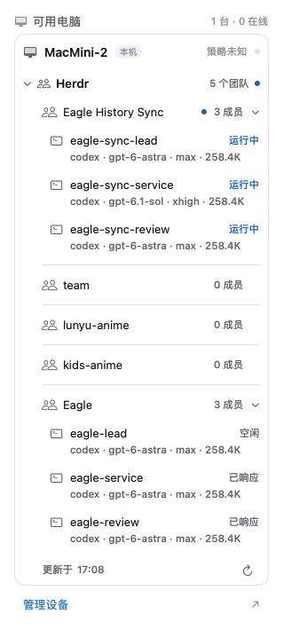

# Shared devices — wire v1

Status: implementation contract, 2026-10-29. Independent of owner/v1 and Bots wire.
Base path `/api/devices/v1`; JSON UTF-8, strict objects, camelCase. All responses
use `Cache-Control: no-store`; errors `{error: code}`. Credentials never use URLs.

The product origin is whatever custom domain the deployment's ignored
`apps/web/wrangler.devices.jsonc` names; it is served by the independent `eagle-devices`
Worker. Examples in this repository use `devices.example.com`. Both Macs use this same HTTPS/WSS origin;
the localhost Registry remains separate. The service reuses `DeviceRegistry` and
`DeviceExecution`, exposes read-only `/api/live` health/version/revision, and rejects
unrelated paths. It has no website, legacy machine API, D1, assets or scheduled jobs.
The website Worker does not expose this device API or bind its Durable Objects.
Local device API and process integration fixtures use this standalone entry too.
The initial `28f4aef` deployment on 2026-10-29 passed public health and
anonymous-directory authentication checks. Current installed App, WSS and physical
Mac acceptance evidence is recorded in [the Bots plan](bots/PLAN.md#helper-startup-recovery-2026-10-30);
operational setup is in [DEPLOYMENT.md](DEPLOYMENT.md).

## Local Herdr teams in the macOS inspector

The conversation's 电脑 tab shows a collapsed Herdr row under the local Mac in
可用电脑. It shows the team count and a small marker when at least one team has a
`working` member. Expanding it initially shows at most five teams, ordered by
working-member count, then blocked-member count, with Herdr order breaking ties.
`查看更多团队` reveals the rest and can collapse back to five. Each team's member
list starts collapsed and opens independently; explicit expansion survives
refreshes. The count and marker keep refreshing while collapsed; paired computers
do not get this row. If the device directory has not been read, its unavailable
or disabled message remains visible separately from the local Herdr row.
A team is a local Herdr workspace. Workspaces without recognized agents remain
visible as compact `0 成员` rows; they do not receive a running marker. It lists
the workspace/session name and each member's name, agent kind and observed
lifecycle state. Small monochrome team/member icons and shallow indentation
follow the machine → Herdr → team → member hierarchy. Machine and Herdr headings
have stronger type than team/member names; member subtitles show model,
reasoning effort and context-window
capacity when recorded, for example `codex · gpt-6-astra · max · 258.4K`. Paths
are not displayed. Missing settings remain unrecorded, never inferred from a
model name, global CLI defaults or another member. `done` means
已响应, not that the team's task has been verified complete. Missing or unfamiliar
states and missing member kinds stay 未知; workspace aggregate badges do not override
member observations.

Expanded inspector preview:

While this panel is visible, the App reads `herdr session list --json`, then
`herdr --session <name> api snapshot` for each running local session, waiting
three seconds after each completed read. Each command and its stdout have a
ten-second timeout; refreshes never overlap. Each session's membership and state come from one
snapshot. It never starts Herdr, reads terminal transcripts, sends agent input,
or uses the device
execution queue. There is no remote-machine collection or cloud storage in this
version. The existing device list and its policies are independent.

Model details are optional local enrichment, independent of lifecycle state.
For Codex, a matching `agent_session` kind and exact session ID identify the
session log under `CODEX_HOME/sessions` (default `~/.codex/sessions`); the log's
session header must agree. Only model, reasoning effort and context-window
metadata are retained. A window is associated with a model only when the events
share a recorded turn ID; unassociated token counts cannot supply a window.
Unchanged files reuse cached metadata; growing files are read incrementally, from
the last complete record. Discovery is limited to one
scan per 30 seconds and 10,000 entries; initial, replacement and large-gap reads
use at most the last 8 MiB, after validating a session header within 64 KiB.
Metadata outside these bounds remains unknown until it is recorded again.
No log activity state machine or additional polling loop is introduced. Missing,
unsupported or unreadable metadata does not prevent the Herdr roster/status read.

Reads are bounded and cancellable. Missing Herdr, no running session, an empty
team list and a failed read are distinct states. After a failed refresh, the last
successful result remains visible with its observation time and unconfirmed
statuses; the refresh action retries the read. Closing the panel stops polling.

## Identity and HTTPS

Device identity is an Ed25519 key persisted by the independent App helper in a
local private file, without querying, unlocking or falling back to Keychain.
The fixed directory is `~/.eagle-device-identities` (0700, current UID); each
profile uses `<SHA-256 of profile UTF-8 bytes>.json` (0600, current UID).
The helper alone reads the identity record. Node, Bots, argv and logs never
receive its private key. Existing Keychain records are left untouched; no
automatic identity migration or deletion occurs.

New records are written completely to a private temporary file, fsynced and
published atomically without replacing an existing record. Concurrent creators
reuse the winner's identity. Directory traversal and file opens reject symlinks;
the record must be a regular, single-link file with the exact ownership and modes
above. The opened directory and record descriptors must have no Darwin extended
ACL entries, including inherited entries. ACL lookup or validation failure fails
closed. New temporary records pass the same ACL check before any private key
bytes are written; existing ACLs are never removed or changed. Existing unsafe,
empty, oversized (>4096 bytes) or corrupt records fail
closed and are never replaced with a fresh identity. Stable errors are
`device_identity_storage_insecure`, `device_identity_storage_unavailable` and
`device_identity_corrupt`. The injectable `DeviceIdentityVault` remains available
for isolated tests; production `loadOrCreate(profile:)` defaults to this file vault.
`deviceId` is a UUID generated once by the App; `publicKey` is base64url DER SPKI.
Signatures are base64url raw Ed25519. Node and Bots never receive the private key.

- `POST /register/challenge` `{deviceId,publicKey,name,platform,arch}` returns
  `{challengeId,payload,expiresAt}`. Sign the exact UTF-8 `payload` (no JSON
  reserialization). The exact seven newline-separated fields, without a trailing
  newline, are `eagle-device-register-v1`, HTTPS service origin (scheme + host +
  optional port), deviceId, publicKey, challengeId, 32 random bytes base64url,
  expiresAt (Unix milliseconds). The helper checks all seven fields against its
  own configured service/identity, UUIDs, nonce size and a future expiry <=60s;
  it must never blindly sign arbitrary stdout.
- `POST /register/complete` `{challengeId,signature}` returns
  `{device,sessionToken,expiresAt}`. The same flow refreshes a session for an
  existing key, never replaces an existing identity. Challenges expire in 60s
  and are single-use. Sessions expire in 15 minutes; only their hash is stored.
- Other HTTPS calls use `Authorization: Bearer <sessionToken>`; credentials are
  memory only. Registration and redemption have bounded server rate limits.
- `GET /directory` returns `{localDeviceId,groupId,revision,observationRevision,devices}`.
  revision tracks durable membership/metadata only. observationRevision is an
  opaque SHA-256 of current device observations, including online lease expiry,
  lastSeenAt, capabilities and policy. Refresh consumers compare both values,
  never suppress observation changes just because membership revision is equal.
  Synchronous pairing-result snapshots use observationRevision `unknown`; refresh
  GET /directory for live observations. Device:
  `{deviceId,publicKey,name,platform,arch,groupId,membershipEpoch,credentialVersion,
  online,lastSeenAt,capabilities,policy}`. `online` is true/false/null (unknown);
  lastSeenAt is Unix milliseconds/null; capabilities is an observed list of
  operation kinds/null; policy is observed policy/null. Only an authenticated
  Agent handshake/heartbeat supplies observations. Missing observation stays
  unknown, never inferred from registration or pairing.
  Ungrouped devices see themselves; group members see all current members.
- `POST /pairings` `{ttlSeconds?:3600}` returns `{code,expiresAt}`; code is 32
  random bytes base64url, maximum TTL 86400 seconds. Only its SHA-256 is stored.
- `POST /pairings/revoke` `{code}` invalidates an unused invitation of this device.
- `POST /pairings/redeem` `{requestId,code}` returns `{requestId,groupId,directory}`.
  Persist requestId before sending. Same requestId with another code conflicts.
- `GET /pairings/results/<requestId>` returns the original committed result plus
  current `directory`, or 404. Same redeemer and same code recover the first
  committed result even with a new requestId. Another redeemer cannot reuse it.
- `POST /members/remove` `{deviceId}` removes self or another current same-group
  member; increments that member's epoch and credential version. Old sessions,
  sockets and invitations fail closed. Removed devices can authenticate again
  with their existing key and pair again; historical results never rejoin them.

Registry SQLite in one deployment-wide DO is the sole authority. Redemption
validates and changes membership, consumes the invitation and stores the result
in one synchronous transaction without network awaits. Two ungrouped devices
create a group; exactly one grouped device retains its group regardless of code
input direction; same group is idempotent; different groups conflict without
consumption. Invitation issuance epoch must still match. Results retain 7 days.

## Execution

Agent opens one outbound WSS `/execution/<targetDeviceId>/agent` and sends
`{type:"authenticate",sessionToken}`; server returns `{type:"ready"}`. Caller
opens one WSS `/execution/<targetDeviceId>/request`, sends
`{type:"request",sessionToken,request:<OperationRequest>}` and receives exactly
one `{type:"response",requestId,operationId,targetDeviceId,result}` then closes.
Every run/get/cancel rechecks live Registry source and target membership.
Authentication/revocation closes use code 1008 with reason `unauthorized_agent`,
`revoked_agent` or `unauthorized_caller`. Only those reasons invalidate the
matching cached session and require fresh helper identity proof on the next connection.
Transport failures, lease expiry and Agent replacement retain a valid session.
An old socket's rejection cannot invalidate a newer session. Reauthentication
never resends an operation; an uncertain result still requires querying its ID.

OperationRequest: `{requestId,operationId,targetDeviceId,action:"run"|"get"|"cancel",
sourceBotId?:string,operation?:{kind:"command",command,cwd?,timeoutMs?}|{kind:"file.read",path}|
{kind:"file.write",path,content}|{kind:"file.list",path},digest?,approval?}`.
IDs are UUIDs; upper/lowercase input is accepted and canonicalized to lowercase
before lookup, routing, comparison or signing. `digest` is lowercase SHA-256 of recursively key-sorted compact
JSON of `operation` (UTF-8; omitted optional fields omitted). Target and digest
are immutable for an operation ID. Source is derived from session, never trusted
from caller. Each forwarding generates a fresh server correlation UUID for the
Agent-facing requestId, bound to that Agent socket generation. Pending state keeps
the original caller IDs and restores them on the caller response. Late results
from a retired request/Agent never match another caller reusing the same IDs.
Relay sends `{type:"operation",sourceDeviceId,sourcePublicKey,request}`;
agent responds `{type:"result",requestId,operationId,targetDeviceId,result}`.
Result: `{status:"running"|"completed"|"failed"|"cancelled"|"unknown"|"busy"|
"denied",output?,error?,exitCode?}`. busy means unaccepted, never queued.
A lost response means query the same ID; never automatically run again or switch
target. Journal admission precedes side effects; interrupted running entries
recover as unknown, never rerun. get/cancel remain usable during a running job.
A target's local operations use the same journal and policy, without cloud.
When a device identity changes, its private journal and fixed socket stay in place.
Every stored result remains bound to both its original source and target identity;
the new identity cannot read, cancel or rerun those operations. Caller request IDs
retain their original target/digest binding, including uncertain remote requests.
Native admission blocks are journal-wide and survive an identity change; only the
existing trusted boot/completion rules can release them. No old row is moved,
retargeted or deleted when adopting a new file-vault identity.

Policy `{mode:"all-approve"|"always-ask"|"paused",version:positive integer}` is
persisted by target. A fresh device with no saved policy defaults to `always-ask`;
a saved policy is preserved. Always ask is confirmed in the initiating App.
Approval envelope `{operationId,sourceDeviceId,targetDeviceId,digest,
policyVersion,expiresAt,signature}` signs exact UTF-8
`eagle-device-approval-v1\n<operationId>\n<sourceDeviceId>\n<targetDeviceId>\n<digest>\n<policyVersion>\n<expiresAt>`.
Expiry is Unix milliseconds, at most 5 minutes ahead. Registry relay and target
verify the initiating device public key and all bindings; `approved=true` is
invalid. Unconfirmed requests are denied, never automatically approved.

## Private App helper and local port

App bundles Node + Agent and launches `dist/agent/device-service.js` with no
credentials in argv or environment. Parent-child stdin/stdout is private JSONL.
App first writes `{type:"configure",version:1,baseUrl,deviceId,publicKey,name,
platform,arch,stateDirectory,socketPath,bootSessionId?}`. stateDirectory is App-private 0700;
socketPath is an App-private Unix socket (0600), not a public TCP port. Public key
and IDs may be persisted there; private key and session tokens may not.

Node requests identity signatures through stdout
`{type:"sign",requestId,payload}`; App/helper replies through stdin
`{type:"signature",requestId,signature}` or `{type:"signature",requestId,error}`.
Only exact requested payloads are signed; helper validates identity/purpose.
Node emits `{type:"ready",socketPath,deviceId}` after local tools/port are ready,
and `{type:"cloud",status:"online"|"offline"|"unconfigured",error?}` separately.
An empty `baseUrl` starts the Node service without a cloud client or network access;
local `status` and `directory` report `cloudStatus: "unconfigured"`. Local policy,
identity, journal and admission still apply. A new remote operation is denied with
`remote_not_configured` without recording it as sent. An existing `sent` operation
returns `unknown` with `remote_not_configured_query_original_id`; its original
binding remains unchanged and cannot become an unaccepted retry. A previously
unaccepted operation is denied as unconfigured. Remote management also returns
`remote_not_configured`. Cloud failure does not prevent local readiness. The
independent identity helper owns the Node lifecycle (SMAppService);
closing the App window does not end this pipe. Helper EOF stops the child cleanly.
The App attempts registration for both `notRegistered` and the first-install
`notFound` state, then requires `enabled` before opening XPC. A background approval
request stays pending until macOS authorizes it; registration alone is not readiness.
The App records a nonsecret fingerprint of the signed App/helper identities, helper
executable and launch plist after successful registration. An updated or previously
untracked enabled installation awaits its own SMAppService unregister callback before
registering the current bundle. Registration success still does not establish OS launch admission.
Unchanged installations keep the running helper. Approval-required state is not reset,
failed registration does not advance the fingerprint, and device identity, journal and
pending pairing records are untouched. The device switch remains accessible during a
status read; stopping still waits for registration and prevents automatic restart.
A successful registration that still needs system approval keeps a separate pending
fingerprint. Approval of that same bundle promotes the record without stopping or
registering its helper again; successful stop clears both installation records.

The local candidate is delivered at `~/Applications/Eagle Device Candidate.app`.
`apps/macos/.build/device-candidate/Eagle Device Candidate.app` remains the build
artifact. Install the signed bundle without re-signing, then open the installed copy;
the candidate bundle/profile and data remain separate from the daily App. This local
ad-hoc candidate is not a distribution-signed or notarized release.
## Where the relay address comes from

A **published App ships no relay address**: `Support/DeviceHost.release.json` carries an empty
`baseUrl`, and nothing in the Swift sources names a host. The person who runs the App names
their own service in **设置 → 设备 → 服务地址**; the choice is stored in the app's defaults as
`eagle.deviceServiceAddress` (an origin only: HTTPS, or `http` on loopback, with no path,
query or credentials) and the helper reads it at start, so changing it restarts the local
service with the new relay. Before an address exists the App starts the local helper and
agent without a cloud client; local policy and tools remain available and no remote service
is contacted. Settings labels the remote as unconfigured and disables pairing actions while
keeping the local policy available.

`EAGLE_DEVICE_SERVICE_URL` remains an optional build input for a bundle that must name an
origin up front (a candidate pointing at a local service, or a deployment that deliberately
pins one). Omitted or empty keeps whatever the profile file says: `http://127.0.0.1:17053`
for a candidate, nothing for a release. The address is validated the same way either way, and
a built-in address is never a requirement for publishing.

Unix socket is JSONL request/response, one response per request:
`{requestId,method,params?}` → `{requestId,result}` or `{requestId,error}`.
Bot port read/execute methods: `status`, `directory`, `execute` (OperationRequest),
`operation.get`, `operation.cancel` (OperationRequest), `local.begin` and
`local.complete` and `local.heartbeat`. It rejects all management writes, including `policy.set`,
`pairing.create/revoke/redeem` and `member.remove`; 0600 alone does not distinguish
same-UID Bots from the App. `pairing.result` is App management only as well.
`local.begin` takes OperationRequest with `operation:{kind:"native",tool,args,cwd?}`
(native CodingTools only); it returns `{accepted:boolean,result,leaseId?,expiresAt?}`. Only accepted
true permits invoking the native tool. Duplicate begin always accepted false,
including a running prior admission. `local.complete` takes
`{operationId,leaseId,result}` and durably finalizes/releases the same device lock.
The initiating Bot keeps the same Unix socket open from begin through complete.
`local.heartbeat` `{operationId,leaseId}` on that socket renews a 30-second lease
and returns `{expiresAt}`; renew every 10 seconds. Socket closure or lease expiry
durably marks the native operation unknown and keeps device admission blocked.
A missing heartbeat never proves that the underlying native tool stopped. This
block survives service restart. Only the original owning lease can settle its
own operation with explicit completed/failed/cancelled evidence; a late completion
on the original socket is allowed. A disconnected owner stays blocked until
the trusted OS reboot proof described below. Unknown completion
does not clear the block. A new random
leaseId is bound to the owning socket; stale/other-socket complete or heartbeat
is rejected and cannot release another admission. No native request is rerun.
Only the initiating local device may complete its native admission. Native and
remote tools share policy/journal/serial admission; interrupted native operations
recover unknown. Native is rejected by remote execute/relay. args is a JSON object;
the complete native operation participates in the same canonical parameter digest.

For reboot recovery, the trusted Swift helper reads macOS `kern.bootsessionuuid`
directly and supplies that UUID as optional `configure.bootSessionId`. It must
read the actual local kernel value on each launch, never accept a Bot/App user
claim or substitute a process/session/random UUID. On read failure it omits the
field. Node canonicalizes UUID case and durably records this identity together
with each native admission. This field is absent from Bot requests, approval
payloads, directory and cloud registration; there is no socket or management
method for setting it or manually clearing a block.

On journal startup, only two present, different trusted boot identities establish
that the original owner's processes and command groups cannot still run. Node
atomically clears that admission's `native_blocked` flag and preserves its result
as unknown, before accepting new work. The original operation ID remains a query
of its unknown result and is never admitted again. Its retired lease cannot
complete it or release a later operation. Same boot (including case variants),
missing current identity, or a legacy admission with no recorded identity keeps
the block. App/Node/Bot restart, cancellation and heartbeat expiry are no reboot
proof. For an admission with recorded boot identity, the honest recovery action
is **restart this Mac**, then let the helper supply the new kernel UUID; reboot
does not prove the old operation succeeded. Legacy unknown-boot blocks have no
automatic recovery. No process supervisor or execution scheduler is involved.

Management uses only the trusted helper's parent stdin:
`{type:"manage",requestId,method,params?}` → stdout
`{type:"managed",requestId,result}` or `{type:"managed",requestId,error}`.
Methods: `pairing.create` (`ttlSeconds?`), `pairing.revoke` (`code`),
`pairing.redeem` (`requestId,code`), `pairing.result` (`requestId`),
`member.remove` (`deviceId`), `policy.get`, `policy.set` (`mode`).
`policy.set` also accepts exactly `{deviceId,mode,requestId}`. The original
`{mode}` remains local and works offline. An explicit target uses a durable
request-ID binding to that target and mode before sending; a reused ID with
different parameters fails `policy_request_conflict`. An already sent ID is
never automatically sent again (`policy_request_already_sent_refresh_target`);
refresh the actual target policy through the directory after uncertainty.
Remote management uses authenticated `POST /api/devices/v1/policy` with the
same three fields. Registry/DeviceExecution recheck current sessions and group
membership before forwarding and before returning success. Target confirmation
returns its persisted `{mode,version}`, never an optimistic source-side policy.
The target's current paused/always-ask policy does not gate this private App
management path. Bot socket management writes remain forbidden, and normal
execute/approval frames cannot carry policy management.

On the existing target Agent WSS, management uses
`{type:"policy.set",relayId,sourceDeviceId,request:{deviceId,mode,requestId}}`;
the target replies `{type:"policy.result",relayId,requestId,deviceId,policy?,error?}`.
The server generates relayId and pins it to the target connection. Source IDs
come only from live Registry authorization. Targets advertise `policy.manage` in
capabilities; older targets fail `target_management_unsupported`, offline targets
fail `target_offline`. A missing confirmation fails
`policy_result_unknown_refresh_target`; there is no local fallback or retry.
Target policy, version and source/request-ID result are committed in one local
journal transaction. Duplicate target requests return their original result
without changing policy again, including after restart; request bindings include
both source and target identity. Legacy policy.json is imported only when no
journal policy exists. Agent 1.2.0 and the updated Worker are required for remote
management; no new Cloudflare resource or DO migration is needed. Older Agents
must not be used to roll back a journal-managed policy.
The Swift helper verifies its App requester code identity; it never exposes a
management credential or stdin handle to a Bot.

Approval is a distinct typed message, never an arbitrary `sign` payload.
Node stdout: `{type:"approve",requestId,operationId,sourceDeviceId,targetDeviceId,
operation,digest,policyVersion,expiresAt}`. Helper recomputes canonical digest,
checks its configured source identity and all bindings, asks the initiating App
to show the complete operation/target and confirm, then replies stdin
`{type:"approval",requestId,approval:<signed envelope>}` or
`{type:"approval",requestId,error}`. A Bot can only propose an approval through
`approval.request` (OperationRequest plus policyVersion/expiry), never approve.
No unattended/timeout fallback. The `sign` bridge accepts registration purpose
only; it rejects approval payloads and all other purposes.
Local directory always includes self;
remote entries are fetched live before remote execution. Multiple Bots share
this port and never copy device secrets. `status` returns
`{deviceId,localReady,cloudStatus,policy}`. App may open the same port for settings.
Settings, the device inspector and App windows share one five-second observation
task while any of them is present. Unchanged background reads publish no UI
changes and do not disable local controls. User mutations supersede older reads,
including their errors; stopped services cannot be revived by delayed replies.
App launch also starts the enabled device service independently of view creation.
Registration and signature inspection run off the UI actor. A registered service
must answer an authenticated, read-only XPC `service.ping` within five seconds;
it returns `{version:1}` without waiting for the Node socket or cloud network.
registration alone never proves that the helper ran. On a transport failure, one
automatic recovery refreshes this App's LaunchServices entry and serially
unregisters/registers its helper before probing again. Repeated failed observations
do not repeat that recovery; successful contact or an explicit retry resets the
budget. Approval, signature validation and protocol failures remain closed.
Normal status and management calls keep their existing deadlines. Local
initialization is observed every 100 ms for up to five seconds, then returns
to the normal observation cadence. Local readiness and policy publish before a
cloud directory request completes. Recovery preserves the enabled preference,
device identity and pending pairing IDs and never replays a management mutation.
Local policy remains available when the cloud directory is offline or stale,
provided the service is enabled, locally ready and its policy is known.
The Add device and detail disclosures use full-width, 44-point-minimum Button
targets; expansion and unfinished pairing input survive observation updates.
The local execution port accepts only operation-bound signed approval envelopes,
not a boolean or reusable approval token; all approval creation uses typed approve.

Local Node development can inject an in-memory signer; production App uses the
private file vault through its trusted helper. No npm publication, deployment or installation is implied by this
contract. Herdr is an optional provider, never needed for file/command tools.

Agent authentication frame includes `capabilities:[operation kinds],policy`;
`{type:"heartbeat",capabilities,policy}` refreshes actual observations every 10s.
Online observations expire after 30s without a heartbeat. sourceBotId is bounded
to 120 characters and is provenance only, never a permission boundary.

All command/file/native outcomes pass the same credential/PEM redactor before
journal persistence. stdout is bounded to 60 KiB and stderr to 4 KiB in UTF-8
bytes, without splitting characters; truncated known-secret fragments are masked.
A valid oversized native completion is sanitized and bounded, then committed.
Journal/storage failure returns unknown and preserves admission; it never reports
an admitted side effect as an unaccepted denial. Admission rechecks policy version,
service closure and approval expiry after asynchronous signature verification.

WS admission checks a 512 KiB per-frame bound before promise queueing. An Agent
socket holds at most 16 pending frames and 1 MiB pending UTF-8 bytes; excess
closes it. A caller socket accepts one frame total. Every asynchronous Registry
return checks that its originating socket and Agent generation remain live;
closed or replaced connections cannot become authenticated again.

Before local/remote dispatch, the shared Node service durably pins operationId,
targetDeviceId and parameter digest in its private journal. IDs cannot move to
another device (including local fallback) or change parameters. After dispatch
or an unknown outcome, another run submission is converted to get for the same
target; no network reconnect automatically resends a run. Explicit busy/denied
responses to an actual run record unaccepted state and allow an explicit retry
with the same binding. Pins survive service restart and never store tokens or
operation parameter plaintext.
