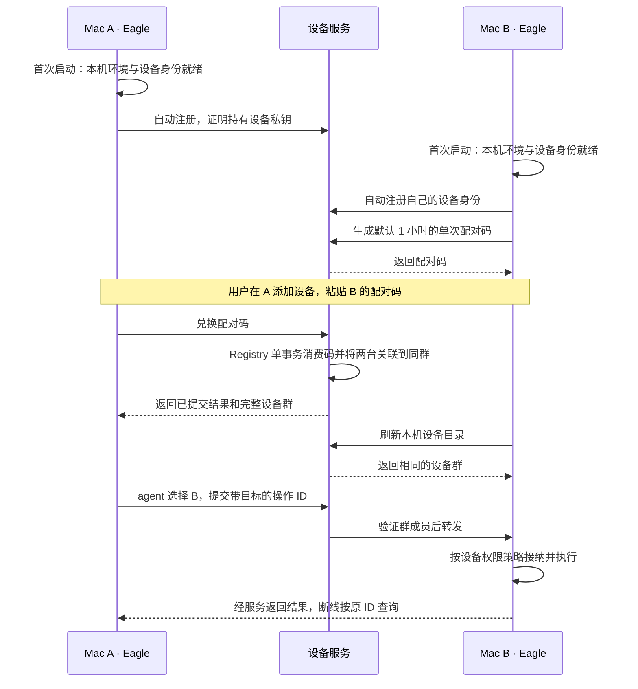
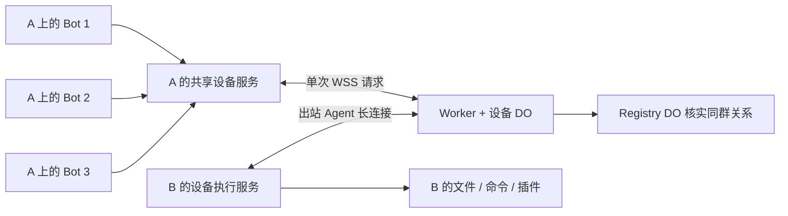

# Eagle 共享设备与配对方案

日期：2026-10-29。状态：已从 `nocoo/eagle@7101566` 启动实施；功能与部署尚未验收。
实施 worktree：`eagle-device-groups`（集成与 App）和 `eagle-device-service`（设备服务）。
用户已明确授权独立 worktree 和小型 Eagle Herdr 团队；旧 `main` 上的改动保留。
阶段进度统一记录在 [PLAN.md](PLAN.md#共享设备与配对重构2026-10-29)。
本方案替代本轮原有“手动部署配置 + 每 Bot 机器授权”的默认产品流程；旧实现的
验收记录仍只证明旧候选，不证明本方案已经可用。实现时同步更新所属产品、架构、
协议和运行契约；本文不直接改变现有 v1 协议。

## 产品行为

- 设备属于 Eagle 的共享设备群。一个 App 配置一次，当前及以后创建的 Bot 都可使用；
  不再为每个 Bot 复制设备名单、凭据或五项权限，也不要求另开远程工具组。
- 群有稳定的 `groupId` 和多个成员，支持 A/B/C/D 等三台以上设备；各成员相互发现，
  群内任意设备上的 Bot 都可调用其他成员，不按两台设备组成一对来组织配置。
- 执行位置由 agent 根据用户指令、实时设备信息和任务需要选择，工具调用明确携带
  目标设备；用户无需先在界面选择电脑。第一版按目标设备串行执行。
- 安装后首次打开 Eagle，自动准备本机执行环境、设备身份和本机工具。本机默认
  All approve，拥有与当前用户下本地 Agent 一致的能力；设备服务不可用时应显示
  真实故障并提供重试，不能用“安装成功”代替就绪。
- 本机操作不依赖配对或云端在线。网络恢复后自动注册/重连，不阻断本地工作。
- 用户无需安装 Node、npm、Herdr 或手填服务路径、部署地址、owner token、
  Cloudflare Access 凭据。Herdr 继续作为按需安装的可选插件。
- “所有权限”指当前系统账户可执行的文件/命令能力；macOS 隐私、辅助功能、后台
  项目等系统授权通过正常系统入口完成，不宣称安装应用能自动取得 root 或 TCC 授权。
- 本轮仍是 A 上的 Bot 向 B 下达机器操作。共享 Bot 聊天、记忆复制、运行主机迁移
  不随设备配对自动实现。

## 用户入口

设置必须能从 App 内 menu 弹窗直接打开，在包含“会话状态、基础控件”等入口的
导航区域提供明确的“设置…”入口；不能让用户只能到系统状态栏/菜单栏寻找。
源码中这组导航位于 `TemplateGallery.swift`，由宿主注入打开真实设置的动作，
不能另做一个只有示例内容的设置页。已有账户菜单、系统菜单和 `⌘,` 入口保留，
都打开当前 App/profile 的同一份设置。

设备设置统一命名为“设备”，Bot 详情的“管理设备”直接打开此页。现有源码的
`SettingsSection.machines`、账户菜单回调和快捷键接线不等于已验证当前安装包里
入口可发现；验收必须实际点击 App 内 menu，再进入设备页完成操作。

设置使用独立可缩放窗口，默认 1120 × 820，记住用户调整后的大小。设备服务在
每次启动 App 时自动启用；"设备"页连接状态一行右侧提供唯一的手动服务开关：关闭会
注销本机 helper 并保留原身份与策略，重新打开即恢复，开关状态不跨 App 实例保留，
页面不提供"关窗后继续运行"的说明。仅在需要时显示启动状态、重试与系统授权入口。

| 区域 | 内容与操作 |
| --- | --- |
| 连接状态 | 本机就绪与云端状态，同一行右侧是本机设备服务的唯一开关；有明确原因时显示重试和系统授权入口 |
| 添加设备 | 始终展开；生成/复制/作废本机配对码不再占用独立标题。另一台配对码输入旁的操作命名“添加设备”。默认有效期 1 小时，最长 24 小时；有未确认请求时直接展示恢复操作 |
| 我的设备 | 保留电脑图标、名称和本机标记；在线状态用带可访问名称的图标，后跟有下划线的“详情”链接展开内容，不显示下拉箭头。每行外侧常驻执行策略菜单，所有移除操作统一命名“移除” |

本机执行策略不再单独占用设置卡片。菜单仍受本机服务就绪、当前策略和操作忙碌
状态约束；云端离线或目录观察过期不单独禁止修改本机策略。远端设备必须在线、
目录有效且声明管理能力，修改经私有管理通道并收到目标持久化确认后才显示成功；
离线、旧版设备或结果未知不乐观修改；结果未知时提示刷新目标实际权限，不自动重发。
Bot 详情中的设备摘要继续展示策略。

“每次询问”的确认由 App 的唯一确认窗口承接，不依赖主工作区窗口是否仍打开。
只剩设置窗口时仍能查看并确认完整操作；关闭确认窗口只拒绝它显示的原请求。

旧候选遗留的关闭偏好不阻止新一轮 App 启动。即使服务正在启动或启动
失败，“我的设备”仍显示本机名称与对应状态；没有读到服务身份时只显示系统提供
的本机名称，不虚构设备 ID、在线状态或权限。本机服务不可用时不能修改执行策略。

候选 App 升级使用随源码提供的安装器：先验证完整新包，正常退出旧 UI，在旧包仍处于
安装位置时等待设备服务注销完成，并独立确认旧 launchd job 与进程退出，之后才替换
整个 App。签名内的能力标记允许安装器调用旧 App 的 `--prepare-device-update` 维护
入口；该入口在 SwiftUI 初始化前分流，不启动 UI、Bot 或云端，不改变启用偏好与设备数据。
旧候选没有该入口时，仅尝试一次新候选维护入口，并验证同一旧 job 与进程确实消失；
不能确认就保留原包，不能仅凭新调用者报告“未注册”继续替换。安装器不访问 Keychain。
旧候选没有维护入口时，不保证跨服务名称自动迁移；无法确认旧服务停止就安全拒绝。

App 启动检测到包更新时，完成旧注册的异步注销后，由后台 actor 刷新当前完整 App，再创建新的
`SMAppService` 对象注册 helper；注册后须通过签名握手和本机就绪检查。
候选与正式包都通过后台 actor 上的 `LSRegisterURL` 刷新完整 App，不另起 registrar 子进程。
只有首次注册、包更新及一次有界握手恢复会重新注册，健康状态轮询不重复注册。
不重置系统数据库，也不放宽签名约束。
每次组装候选包使用独立的 `CFBundleVersion`，区分产品版本相同但签名不同的构建；
新包使用固定的 `EagleDeviceHelper` 文件名；签名、App 的 helper 身份验证和安装器的
进程归属检查均从签名包内同一 plist 读取真实路径，兼容旧候选的版本化 helper 文件名。
候选服务 label、Mach service 与 plist 文件名包含同一次 build，避免新的 helper 签名复用
旧服务的启动约束。安装器从旧签名包读取旧名称并确认该 job 消失，再安装新名称；
若新名称已被其他安装占用，在退出旧 App 前拒绝替换。
安装器只读列举当前用户的候选服务；发现旧/新包以外的候选名称时同样拒绝，不停止其他安装。
`device-candidate` profile、socket、设备身份和持久化目录保持不变。
正式发布与旧候选的固定服务名、固定 helper 路径仍受支持。
候选 helper 使用固定的签名 identifier，避免继承链接器每次变化的 UUID 标识；ad-hoc
产物的 designated requirement 仍精确绑定当前 CDHash，不能用同名程序替代。
显示用的 `CFBundleShortVersionString` 仍取产品版本，正式发布包保留发布版本规则。

Bot 详情保留“可用电脑”，显示本机、群内设备、状态和 agent 当前实际执行的目标，
并提供“管理设备”入口。用户可以在指令中指定电脑；界面选机器不作为执行前置步骤。
设备离线不能把已经指定 B 的操作悄悄改在 A 上执行。

默认服务地址随 App 的环境配置发布，开发环境使用独立配置。Cloudflare 运维参数
不进入普通用户页面，也不能通过把共享 owner secret 打进 App 来省略认证。

## 配对码与持久设备身份

配对码和日常连接凭据是两件事：

| 类型 | 生命周期 | 用途 |
| --- | --- | --- |
| 设备私钥/身份 | helper 持久保存于本机私有文件，目录 0700/文件 0600 且无扩展 ACL；不访问旧 Keychain | 证明是哪台设备，恢复连接和取得短期会话 |
| 配对码 | 高熵、单次使用；默认 1 小时，可选更短/更长但最多 24 小时 | 允许另一台设备建立同群关系，将新设备纳入已有群 |
| 连接会话 | 短期、自动刷新，受设备成员资格及撤销状态约束 | 访问目录和执行通道，不要求用户手工复制 |

每台新设备自动获得独立身份；首次配对前 `groupId` 为空，设备页仍显示本机，
本机工具正常可用。首次配对后建立真正的群，设备不需要与每个已有成员逐一配对。
每个成员均可生成配对码；UI 说明加入同群会让双方及原群内成员按设备策略互相访问。

生成配对码与输入配对码的方向，不决定哪边必须放弃已有群：

| 配对前状态 | 同一事务内的结果 |
| --- | --- |
| 两台均未入群 | 创建一个群，两台一起加入 |
| 一台在群 G，另一台未入群 | 新设备加入 G，G 的其他成员保持原关系 |
| 两台已经同群 | 返回已关联，成员关系不变 |
| 两台分别在不同的已有群 | 明确返回群冲突，不消费码；本期不自动合并两个独立群 |

例如 A/C 已在群 G，B 刚安装 Eagle：在 A 输入 B 的码，或在 B 输入 A 的码，
结果都为 G = {A, B, C}；D/E 后续按相同方式加入，所有设备和 Bot 看到完整群。
第一版每台设备属于一个群；离群/被移除后可重新配对，设备私钥不因普通离群而删除。
配对码到期只影响尚未完成的配对，不会让已经配对的电脑掉线；用户可提前作废码。

## 配对原子提交与恢复

第一版由一个部署级 `DeviceRegistry` DO 作为设备身份、群成员与配对的唯一权威，
使用该 DO 自身的 SQLite 事务。设备 DO 只承载在线连接、执行转发与观察值；
配对成功不依赖向多个 DO 写入成功。当前规模先不做 Registry 分片或分布式事务。

| Registry 内的数据 | 关键内容 |
| --- | --- |
| devices | 设备 ID、公钥、凭据版本、可空 groupId、成员资格版本、撤销状态 |
| groups | 群 ID、名称、目录 revision；成员关系以 devices.groupId 为准 |
| pairings | 随机配对码的摘要、生成设备及其成员资格版本、到期时间、消费/作废状态 |
| pairing_results | 兑换设备、requestId、配对码摘要、提交结果与时间；请求幂等及断线查询用 |

配对码至少 32 字节随机值，只在生成响应/当前 UI 中出现，原文不落库、日志或 URL。
设备改变所属群或被撤销时，旧成员资格版本签发的未使用配对码失效；单纯新增其他
群成员只递增目录 revision，不使同群其他设备的邀请失效。

兑换用一个同步存储事务完成以下步骤，事务内部不访问网络：

1. 验证当前设备身份；按设备 ID + requestId 查询旧结果，重复请求必须匹配同一摘要。
   同一设备再次提交已由自己消费的码，也返回原结果；其他设备不能接管这次兑换。
2. 新兑换校验码未使用/未作废、尚未过期、生成设备仍有效且成员资格版本一致。
3. 按上表决定创建群或加入现有群，更新实际变化的 devices.groupId/成员资格版本，
   更新群目录 revision。不同已有群的冲突使整个事务回滚。
4. 标记配对码被本次设备消费，保存幂等结果，与群成员变更一起提交。

客户端发请求前保存非敏感 requestId。提交前失败没有部分成员变更；提交后回包丢失，
客户端用原 requestId 查询或重试，读取已提交结果。已完成兑换的重试先读旧结果，
不因邀请随后到期而误报配对失败；同时返回当前成员状态，不能借历史成功恢复已撤销
的关系。结果保留 7 天，清理后仍可通过当前设备目录恢复 UI，过期码不会被重新执行。

群成员变更提交后，客户端刷新目录。通知或设备 DO 缓存更新均只做加速，失败不回滚
成员关系；每次新远程请求都向 Registry 核实来源与目标的当前同群关系，旧缓存或
JWT 中的历史群信息不能单独放行。必要的注册/兑换限流也由服务端执行。

## 安装和连接流程



运行时与 Agent 随安装包提供并签名，正常使用不再依赖 Homebrew、shell PATH 或
用户选择 Node 路径。当前候选已经内置 Node、Bots 和 Agent；本机升级验证不能
直接当成“干净 Mac 上安装即用”的完成证据，新机器首次安装仍需单独验收。

后台机器执行延续独立服务生命周期，关闭窗口后仍可接受已允许的远程操作，
设备策略可暂停执行。开机登录后的恢复使用受支持的 macOS 后台机制和系统
授权。Bot daemon 的生命周期与机器服务分别处理，不借此暗中改变 Bot 托管方式。

## 配对和多个 Bot 共用的通道

设备配对使用 HTTPS 控制接口，执行和实时状态使用出站 WSS；本机设备服务统一
管理设备身份与调用入口。配对码只用于建立成员关系，不作为每次执行时发送的密码。

| 通道 | 具体职责 |
| --- | --- |
| HTTPS 注册/认证 | 注册设备公钥，完成持有证明，取得/刷新短期设备会话 |
| HTTPS 配对/目录 | 生成/作废邀请，原子兑换/查询，读取目录和撤销成员 |
| 目标设备出站 WSS | 一个执行 Agent 长连接，维持在线、心跳、接收操作；断线自动认证后重连 |
| 调用端单次 WSS | 按现有模式发送一次 run/get/cancel 请求，取得结果后关闭连接 |
| 本机 IPC / loopback | 多个 Bot 调用同一个设备访问服务，不接触私钥或复制云端管理凭据 |

第一版共享设备目录、身份和访问服务，保持现有的单次请求连接形态，不引入调用端
长连接池、多路复用或并发任务调度。目标设备同一时间接纳一个新操作；意外重叠时
明确返回未接纳的 busy，agent 后续再尝试，不做后台自动排队。同一操作的 get/cancel
仍然可用。按设备串行不意味着整个设备群只能有一台电脑工作。

目录在配对完成、打开设备页和 agent 选择远端前刷新；前台设备页每 5 秒刷新，
使用 revision 避免重复替换相同数据，初版不另建目录推送通道。每次执行的成员资格
仍以服务端实时授权为准。操作状态先支持执行中、最终结果和主动查询，流式 stdout
不是本轮共享设备的前置能力。



A 和 B 都主动连接公网服务，不要求它们在同一 Wi-Fi，不开放电脑入站端口，
不需要用户填写 IP 或配置端口转发。群内设备互相发现，双向调用使用同一模式；
本机目标直接在本机执行，云端不可用不改变本地执行能力。

每次操作携带 `requestId`、稳定的 `operationId`、
`targetDeviceId`、来源 Bot 标识及工具参数；来源设备和设备群从已认证连接派生。
返回结果匹配请求、目标和操作 ID，再交还原 Bot 会话；保留现有帧和输出界限。

Registry DO 负责成员关系和目录，设备 DO 复用现有 Agent/调用端转发及租约机制；
run/get/cancel 每次接纳都核实当前来源和目标，配对前身份只能访问本机管理和配对。
执行端接纳前验证设备策略，操作 journal 保持原 ID 去重。断线恢复的是连接与
状态/结果，不能自动重发一个产生副作用的新操作。目标离线直接报告离线/不可用，
第一版不隐式排队等待某天上线再执行。

## Agent 自主选择执行设备

Bot 运行主机保持不变，agent 可以为不同步骤选择不同的执行电脑。沿用现有 native
CodingTools 处理本机步骤，远端步骤经过共享设备适配器；不因新增设备而把所有本机
工具改成云端调用，也不依赖 UI 选择器暗中修改 `NodeExecutionEnv`。

复用现有 remote extension 的工具职责：`remote_status` 改为读取 App 共享目录和
设备实时能力，`remote_execute` 显式指定稳定的目标设备 ID，`remote_operation`
查询/取消原操作。新能力的字段和版本入口随实现固定，旧 v1 不静默改语义。
工具组随 Eagle 接入自动可用，不再让用户逐 Bot 启用。设备信息包括名称、系统、
架构、在线状态、可用工具/插件和可选用途说明；不凭设备名称推断文件已经存在。

引导加入 agent 系统说明，并通过工具结果提供当前数据：

```text
你可以使用 Eagle 设备群中的电脑，本机是 <localDeviceId>。
用户指定了电脑时遵循该目标；否则根据任务、资源位置和设备能力自行选择。
没有使用远端的理由时使用本机。需要其他电脑时，先读取当前设备列表和能力。
本地 read/write/edit/bash 操作的是本机；远端步骤使用 remote_execute 并明确目标 ID。
需要确认目录或文件位置时先查询目标，不把另一台电脑的绝对路径当成本机路径。
已提交的操作目标保持不变；发送后失联、超时或结果未知时，先查询原操作。
设备繁忙时不要并发追加任务；明确未接纳的请求可稍后再试。
```

每次远端调用在发送前保存目标、参数摘要和原 operationId；网络重连、设备改名或
模型恢复不能改变该操作的执行位置。agent 能在后续新步骤选择其他设备，用户看到
的实际执行目标以工具回执为准。本轮不自动同步仓库/文件；任务需要的资源由 agent
查询并按既有文件/命令能力处理。

## Orca 可参考的机制

以下按 `stablyai/orca` 的固定源码快照
`631d84d0af9bd92d329600c4a8ed7e0ff06896dd` 核对；是机制参考，不表示 Eagle 已实现，
也不把 Orca 某一条通道的能力推广到它所有连接模式。

| 已核对机制 | Eagle 如何采用 |
| --- | --- |
| 主机主动建立 control WebSocket，通过连接通知协调数据通道 | 复用“电脑主动出站 + 中继路由”，把连接管理放设备层 |
| 一次性 invite 与后续 resume 凭据分开，安装/续期有请求 ID 和结果查询 | 区分配对码、持久身份、短期连接会话；兑换/认证回包丢失可安全查询和重试 |
| 邀请只持久化摘要，并记录过期、已使用、撤销及尝试状态 | 在 DO 中原子兑换；Eagle 的 1 小时默认、24 小时上限按本产品要求实现 |
| 主机公钥及带上下文的 challenge/proof，握手完成后才进入 active | 绑定真实设备身份及连接上下文，不把客户端提交的设备名/群 ID 当身份 |
| splice 以双向帧转发为主，含背压和有界队列 | 复用现有 Eagle relay 的转发与输出界限，初版保持单次请求、按设备串行 |

关键源码：

- [控制连接与主机握手](https://github.com/stablyai/orca/blob/631d84d0af9bd92d329600c4a8ed7e0ff06896dd/src/main/runtime/mobile-cloud-relay/relay-control-client.ts#L69)
  与 [主机持有证明](https://github.com/stablyai/orca/blob/631d84d0af9bd92d329600c4a8ed7e0ff06896dd/src/main/runtime/mobile-cloud-relay/relay-host-proof.ts#L31)。
- [邀请生成、摘要与原子状态](https://github.com/stablyai/orca/blob/631d84d0af9bd92d329600c4a8ed7e0ff06896dd/cloud/apps/relay/src/credential-store.ts#L166)
  与 [凭据安装/续期契约](https://github.com/stablyai/orca/blob/631d84d0af9bd92d329600c4a8ed7e0ff06896dd/src/shared/mobile-relay-credential-contract.ts#L17)。
- [帧转发和背压](https://github.com/stablyai/orca/blob/631d84d0af9bd92d329600c4a8ed7e0ff06896dd/cloud/apps/relay/src/splice-forwarder.ts#L46)。

需要保留的区别：这个 Orca 快照的
[mobile relay offer](https://github.com/stablyai/orca/blob/631d84d0af9bd92d329600c4a8ed7e0ff06896dd/src/shared/mobile-relay-pairing-offer.ts#L83)
明确拒绝 runtime scope，invite 窗口是 10 分钟，因此不能直接视作已经实现了
本方案的任意 Mac 设备群互控。它的 director/cell 分配、PG 状态和多区域容量调度
不是本轮 Eagle 的必需组件；继续用现有 Worker/DO，不另起一套同等规模的部署系统。
Orca 的该 offer 还包含公钥固定与 E2EE framing；Eagle 的设备认证和 TLS 转发
本身不等于端到端加密，若加入 E2EE，需要单独固定密钥验证和消息加密契约。

## 设备级权限策略

每台设备拥有一份“接受 Bot 操作”的策略，默认 All approve，对群内所有 Bot 生效。
本机 Bot 与远程入口需要遵循同一设备策略，不能只在某个界面上改变文案。

| 策略 | 执行行为 |
| --- | --- |
| All approve / 全部允许 | 已认证的群内操作自动执行，不再逐 Bot 或逐命令额外配置 |
| Always ask / 每次询问 | 先等待用户确认，拒绝或超时不执行；无人确认不能降级为自动允许 |
| 暂停访问 | 停止接受新的设备操作；移除设备则另外撤销群成员资格 |

Always ask 固定在发起指令的 Eagle 确认，支持目标机器无人值守；
完整 typed operation 与签名格式已固定于 [设备 v1 wire](../DEVICES.md)。执行端必须验证本次确认绑定的操作 ID、
来源/目标、完整操作参数摘要、策略版本及有限有效期，不接受可复用的
`approved=true`。参数变化重新确认；断线重试沿用原操作身份和审批状态。
状态查询和已有操作结果查询不触发新的执行审批。

策略由目标设备的服务执行与持久化。设置可以展示群内各设备策略；远程修改必须
经授权并收到目标确认才显示已生效，离线不能假装设置成功。切到暂停/撤销不表示
已经产生的副作用被撤销；运行中操作的查询和取消仍按原 ID 处理。

All approve 下，专用文件工具与命令应覆盖当前账户可访问的资源，不再要求用户
逐目录授权才能获得默认本机体验。现有受限目录 provider 可以作为可选高级能力
复用，但它不能限制 shell 的系统权限，也不能声称构成完整设备沙箱。

## 实现分层和持久化

| 层 | 职责与保存位置 |
| --- | --- |
| Eagle App | 设备设置、配对码交互、人工确认、系统授权引导；Bot 详情只消费共享设备目录 |
| 本机设备服务 | 唯一设备身份、连接、设备策略、执行和审批校验；私钥由 helper 保存于本机私有文件，短期会话仅在内存，策略与操作 journal 保留在原私有目录 |
| Bot 适配器 | 枚举共享设备、选择目标、提交/查询/取消操作；Bot ID 是来源追踪信息，不是独立设备授权单位 |
| Cloudflare Worker + Registry DO | 唯一设备/群/配对权威，同一事务消费码并入群，保存公钥/摘要和幂等结果，核实当前成员关系 |
| 设备 DO | 设备连接、在线观察和执行转发；保存必要路由/租约元数据，成员权威由 Registry 提供 |
| D1 | 保持已有报表归档职责，不保存设备私钥、配对码原文或长效管理 token |
| Bot 自身存储 | 聊天、工具结果、记忆仍由当前 Bot 主机保存，配对不复制这些数据 |

Bot 通过本机共享访问接口调用设备服务，不获取每 Bot 的 owner token 副本。
保留必要的私有 helper/IPC 用于安全认证，删除围绕每 Bot 复制和回收凭据的协调流程。
本机工具继续复用已有 native CodingTools；审批使用统一接缝，不新写一套 coding 引擎。
Bots 仍是独立包，通过版本化 port/适配器接入，不导入 Eagle/Worker/Agent 源码。

旧 owner 路径的目录仍使用 `getByName("fleet")`；当前设备 v1 已实现独立的
Registry 成员认证与群隔离：注册挑战证明私钥持有，短期会话绑定真实
设备身份；Registry 按已验证的成员资格派生群、目标及可见记录，拒绝客户端自行
指定其他群来访问。设备群是认证边界，不复用现有仅用于展示的 machine groups。
移除设备使其新连接、邀请和旧会话失效，已有通道应关闭或在协议规定的有限租约内
失效。安装注册入口也需要最小限流与资源配额，不能内置一把全体用户共享的管理钥匙。

## 旧代码处理

新实现基于 `nocoo/eagle@7101566`。旧候选 `c34be59` 留作只读复用来源；
下表涉及的执行/恢复代码若上游尚未包含，按新契约选择性移植，不能整支合入。
不引入旧逐 Bot 授权界面，也不让旧授权名单与新设备群共同决定权限。

| 旧实现 | 处理方向 |
| --- | --- |
| `BotRemoteGrantView/Model`、`BotRemoteSharing`、`BotSharedConnectionWriter` 的逐 Bot 撤销协调 | 新路径移除，改为 App 共享设备及设备级策略 |
| `BotsWorkspace`、`InspectorColumn` 的机器授权入口 | 改成“可用电脑”和共享设备设置入口，去掉逐 Bot 权限表单 |
| `MachineSettingsView/Model` 的部署/Access/Node 手填流程 | 替换为设备页和自动初始化；部署细节留给开发/运维配置 |
| 凭据 helper/私有文件 | 保留私有通信和代码身份认证；设备私钥使用 0700/0600 且无扩展 ACL 的私有文件，不查询或回退旧 Keychain，不复制旧 owner 凭据 |
| Agent service、launchd、身份恢复、WS transport | 保留可复用机制，改接自动配置及新设备认证 |
| operation journal、去重、查询/取消、断线恢复 | 保留，扩展设备来源和审批状态，重连仍不重新执行未知结果的命令 |
| command/file/Herdr providers | 复用执行与界限控制，改接统一设备策略；Herdr 仍可选 |
| Cloudflare relay 和机器目录 | 复用转发机制，补设备群成员认证与隔离，不直接沿用全局 owner/fleet 作为用户隔离 |
| 旧回归与 fixtures | 保留仍适用的执行/恢复证据，替换已移除产品流程的测试，新增配对与共享场景 |

既有 v1 HTTP/WS 契约只能做兼容性扩展。旧每 Bot `remote-tools` API 不再作为新
路径的配置来源；实现时核查兼容使用方，通过明确的新能力/版本入口切换，旧契约
需要时保持独立兼容，不能悄悄改变 v1 字段语义或删除 normative fixtures。
旧候选尚未发布的 UI 和内部协调代码可以直接随替换切片删除。
新配对设备使用独立接口/设备 DO 命名空间，旧 owner/v1 路径不能凭 machineId 访问
新群资产。旧 owner 部署不自动转换为用户设备群，不从旧 token 推断新群成员资格。
不删除现有聊天、用户配置或其他开发者的未提交工作；迁移后清理已废弃的秘密引用。

## 验收与交付顺序

阶段与状态只在 [PLAN.md](PLAN.md#共享设备与配对重构2026-10-29) 维护。
每个行为切片先展示失败行为，再做最小实现和相关检查；整体验收与交付跑仓库要求
的完整门禁，不为文档方案重复跑执行端或浏览器全量测试。

首个贯通切片就验证干净 Mac A/B 上仅安装 Eagle、本机工具自动可用、粘贴配对码后
双向执行；默认 All approve、App 内设置入口和多 Bot 共享一起进入主线。A/B 真实
双 Mac 验证尽早进行，完整交付门禁仍在集成候选上执行。

群语义至少覆盖 A/B/C/D 四个设备身份：A/C 已入群，再从任意一边输入 B 的配对码，
保留原群并加入 B，随后 D 加入，四台都能看到完整目录。已有和新建的多个 Bot
按顺序调用不同设备，新增成员无需逐 Bot 配置。物理 A/B 验收与补充 C/D 的隔离
Agent 实例证据分开记录，不把四个进程称为四台物理 Mac。

agent 路由验收包括用户明确指定 B、未指定时依能力选择、同一任务不同步骤使用
不同设备，以及 B 离线时原操作不落到 A。结果由目标机器上的实际文件/命令证据
核对，不以模型文字或设备列表出现目标为完成依据。

入口验收从 App 内包含“会话状态、基础控件”等项的 menu 开始，点击“设置…”再进
“设备”，同时检查账户菜单和 `⌘,` 打开相同配置，不能只从系统菜单启动设置来替代。

还要验证配对过期/已用/作废、事务中断和回包丢失、重复兑换与不同码争抢同一设备、
不同设备群不可互访、设备移除后的旧连接、Always ask 的拒绝/超时与参数绑定、
离线不误报成功、退出窗口后执行端
存续、升级保留身份、断线/崩溃不重复执行命令，以及安装包含正确签名的运行时。
多操作并发调度/吞吐不在首版范围；重复兑换验证只保护配对一致性，意外执行重叠
只验证明确 busy、不会串结果或误执行。

现有生产尚未部署旧候选的 owner/execution 路由，更没有本方案的配对服务。
默认地址写进安装包之前，要完成对应服务的兼容验证和已授权部署；实施先完成可审查的本地候选；公网部署、npm 发布与日常 App 替换另按具体操作授权执行。
