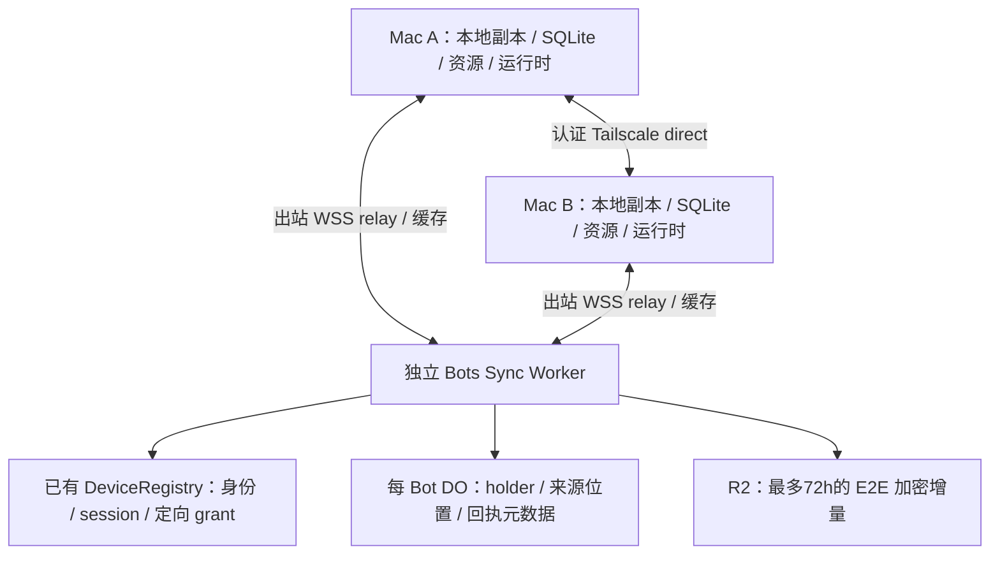

# 多端 Bot 同步架构

历史长期保存在各设备；认证的 Tailscale 直连优先，独立 Bots Sync Worker
提供临时缓存和在线 holder 转发。同一 Bot 的各端独立运行，保留并发分支。

## 当前状态

- 已交付：本地副本/原始历史和完整资源、定向授权与互证、72h 加密缓存、
  自动回退/稳定切回、在线 holder 补读，以及独立的持久状态上报/读取。
  all-path 历史交付为 `193f75bd` / tree `73695d14`。
- P5 source-v6 `a4e8d4b3` 及正常受影响门禁已接受：有界 head 目录、持久 context、
  两父合并/资源选择、原 composer/Outbox 和 owned 原生 composition 已接通。
  A/B 真实原生选择/发送与同身份 App/daemon 重启、两机 API/SDK 接力和并发、
  过期后 B→新 C relay 补齐均有各自有限收据，B `482935b0` 与最终文档/树已正式接受。
  B 发送前中断仍未定因；恢复后的有限实链通过不表示中断已修复。
- 物理 scene5 已证产品 direct→owned cache→direct；direct 运行在 Tailscale DERP
  上，后备是隔离 Miniflare。scene6 使用 owned 原 alarm 的到期时间窗口；
  不将这些证据扩称 UDP P2P、真实墙钟72h或已部署 Cloudflare。

`182fc1f704774eb37bdbc11cde017f8ff61f1c1a` 是本次开发的历史共同基线。
本轮先整合固定 upstream `8674a3ee`，再按实际 main 追加固定
`19f4a00aec5204a336444d631a5d40b36d035d0c`，
[PR #112](https://github.com/nocoo/eagle/pull/112) 的目标为 `nocoo/eagle:main`。
各 head 的正常检查、PR 准入与有限证据分别记录，见
[PLAN](PLAN.md)、[SYNC-NATIVE](SYNC-NATIVE.md) 与 [TESTING](TESTING.md)。

## 组件与数据边界

App 连接本机 daemon；共享历史与本机执行库分开，交换事件而非复制活动 SQLite。
Worker 在内存转发 E2E 密文；DO 持久化身份、holder/source 位置和 ACK 等元数据，
不存聊天正文或完整基线。R2 不是长期历史库。独立 Sync Worker 通过命名
service-binding 复用 Registry，不耦合网站/报表 D1，也无需新增通用目录权限系统。

| 数据 | 边界 |
| --- | --- |
| 原始消息、input/output/tool result、分支、压缩和来源 | 各端持久保存；被动接收不重新调用模型/工具 |
| `AGENTS.md`、附件、完整版本 skills（脚本/引用/资产） | 校验原字节，按所选资源版本加载到执行设备 |
| 本地任务、provider 会话、待执行队列 | 留在本次执行设备，不因同步变成另一端可执行任务 |
| 工作区环境、权限、API key、设备私钥 | 本机配置/安全存储，不作为聊天资源或同步正文传输 |

一个共享 Bot 对应各端独立的完整 local binding；publisher、holder 和原 source
不折叠。事件以 `replicaId + epoch + seq` 定位。历史 head 不可变，本地 context
分别保存 seed、可变 tip 和 resourceHead。两端从 H 并发时保留 H→A、H→B；
显式合并引用两个 parent，按原 origin/有效 edit 去重并显式选择资源冲突，不改原文。
请求 ID、context 和资源选择先入 Outbox，重试/换窗口/重启仍归原请求；合并与导入不执行。

## 连接、授权与确认

- direct 仅监听/发布真实已就绪的 Tailscale Self（100.64/10 或 fd7a:115c:a1e0::）。
  地址是候选，实际读取仍需完整身份互证、当前 holder→reader grant 和使用点检查。
  没有 Self 不妨碍本机运行或独立出站 relay；不伪造 LAN 地址为 Self。
- direct 网络竞争为2.5s；CF 驻留至少30s、完整 probe 间隔至少15s，稳定后下一轮切回。
  cache 缺口/无基线才从当前授权在线 holder relay 补原 source；auth、SQL、schema、
  crypto 失败保持原分类/cause/trace，不借 fallback 洗成 gap。
- 每页最多128事件/8MiB；每页/对象 fresh 互证。pending 数/字节、body、requestId、
  超时/取消和旧 socket 回调均有界。local pendingApply 重试优先，入站总数≤2，
  独立 upload 一槽；缓存与 relay 内部变化不伪造 direct 成功。
- helper 只处理 typed 身份、授权、签名/密钥 metadata，不承载正文、通用 signer
  或远端管理 bearer。供给只使用已 ready 的副本，不自动 open/recover/run。

`received`、实际 `applied`、带到期时间的 `cloudCached`、发送端所知 `peerApplied`
分开。当前 receiver 从互证后的持久库上报，holder 独立读取；确认绑定双方完整身份、
receiver binding、原 source/epoch 和服务端记录时点。未知当前 binding/没有确认即 unknown，
旧 epoch 不冒充新实例，applied 不从 received 推算，确认也不表示远端 run 完成。
本机运行/已成功 apply 不等待 metadata ACK；恢复后读原 DB 补报，不重复 get/apply。

## 72h 与缺口恢复

`expiresAt = firstCachedAt + 72h`，从原事件首次成功缓存算起。读取、重试、重新分页、
换对象/信封和设备离线都不续期；到期停止补发，原 alarm tombstone/expired 后实际删除
R2 对象，失败沿原清理重试。relay 透传旧历史，不重缓存过期历史或刷新原事件钟。

新设备配对并获当前定向 grant 后，从可用缓存补增量；缺失/到期时向任一完整持有者
补原始历史与资源，不绑定创建设备。A 离线但 B 完整在线，C 仍可从 B 恢复。
空目录、空页或 known 上界不证明完整基线；所有 holder 离线时如实 needs_baseline/gap，
已有完整本机副本继续 native。完整依赖落盘并 applied 后才可作为本机新 run 的上下文。
撤销阻止后续共享，不擦除已下载历史；已固定 pin 的离线本地 apply 保持原语义。

## Orca 借鉴

固定源码引用：`6b937c7e5f5a8d2cfcb755c6708ac38a632b3012`。
Orca 所查路径是选定主机上的远程会话；跨运行时可运行副本、多父合并和被动导入
是 Eagle 的扩展，不能从远程访问/中继本身推导已实现。

| 机制 | Orca 做法 | Eagle 如何采用 |
| --- | --- | --- |
| [目录同步][orca-catalog] | 先快照、后增量，扫描期间缓冲变化 | 群目录发现 Bot；目录与 run 状态分开 |
| [持久日志][orca-journal] | SQLite journal 按会话、epoch、seq 排序，事务提交后发布 | 每副本独立来源日志，先落盘再同步 |
| [断线补读][orca-catchup] | 从已应用游标恢复，失效时 reset，有界窗口外另行分页 | 先取仍有效的缓存，缺口向在线副本补读；基线声明覆盖范围 |
| [命令去重][orca-receipts] | 持久操作 ID、内容指纹和结果回执 | 重试沿用原 ID；未知结果先查询，避免重复执行 |
| [连接恢复][orca-transport] | 手机直连/中继切换，隔离旧连接回调 | Tailscale 优先、Cloudflare 回退；恢复后稳定切回，共用游标与去重 |
| [云中继][orca-relay] | 有界内存队列转发帧，聊天历史由运行主机保存 | DO 转发、各端保存历史；3 天缓存是 Eagle 增加的补发能力 |
| [流式合并][orca-stream] | 普通 assistant 更新约 48 ms 合并，关键事件立即发送 | 合并预览更新，本地持久日志负责恢复，不逐 token 缓存 |
| [技能包][orca-skills] | manifest 固定版本与文件清单，完整包传到执行端 | 从副本传输完整包，可选 R2 临时中转；各端校验并固定版本 |

Orca 手机 [direct 入口][orca-direct] 区分 LAN/Tailscale，其能力不直接推广为所有桌面路径。
详细固定源码分析保留在 [SYNC](SYNC.md)。阶段过程与当前状态由 [PLAN](PLAN.md) 管理；
运行/协议以 [RUNTIME](RUNTIME.md) 和 [PROTOCOL](PROTOCOL.md) 为准。
P3/P4 的细合同分别见 [SYNC-AUTO](SYNC-AUTO.md)、[SYNC-CACHE](SYNC-CACHE.md)、
[SYNC-RELAY](SYNC-RELAY.md)、[SYNC-STATUS](SYNC-STATUS.md)；原生与当前物理准入见
[SYNC-NATIVE](SYNC-NATIVE.md)，原红绿/失败/证据范围保留在 [TESTING](TESTING.md)。

[orca-catalog]: https://github.com/stablyai/orca/blob/6b937c7e5f5a8d2cfcb755c6708ac38a632b3012/src/main/runtime/rpc/methods/session-tabs-inventory.ts#L88
[orca-journal]: https://github.com/stablyai/orca/blob/6b937c7e5f5a8d2cfcb755c6708ac38a632b3012/src/main/native-chat/agent-session-journal/journal-row-writer.ts#L55
[orca-catchup]: https://github.com/stablyai/orca/blob/6b937c7e5f5a8d2cfcb755c6708ac38a632b3012/src/main/native-chat/agent-session-wire/agent-session-subscriber-catch-up.ts#L51
[orca-receipts]: https://github.com/stablyai/orca/blob/6b937c7e5f5a8d2cfcb755c6708ac38a632b3012/src/main/native-chat/agent-session-journal/command-receipt-table.spec.ts#L60
[orca-transport]: https://github.com/stablyai/orca/blob/6b937c7e5f5a8d2cfcb755c6708ac38a632b3012/mobile/src/transport/stable-logical-rpc-client.ts#L232
[orca-direct]: https://github.com/stablyai/orca/blob/6b937c7e5f5a8d2cfcb755c6708ac38a632b3012/mobile/src/transport/mobile-endpoint-lifecycle.ts#L90
[orca-relay]: https://github.com/stablyai/orca/blob/6b937c7e5f5a8d2cfcb755c6708ac38a632b3012/cloud/apps/relay/src/splice-forwarder.ts#L47
[orca-stream]: https://github.com/stablyai/orca/blob/6b937c7e5f5a8d2cfcb755c6708ac38a632b3012/src/shared/structured-agent-session-coalescer.ts#L8
[orca-skills]: https://github.com/stablyai/orca/blob/6b937c7e5f5a8d2cfcb755c6708ac38a632b3012/src/shared/skill-package-manifest.ts#L14
