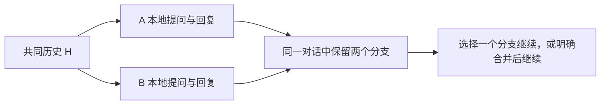
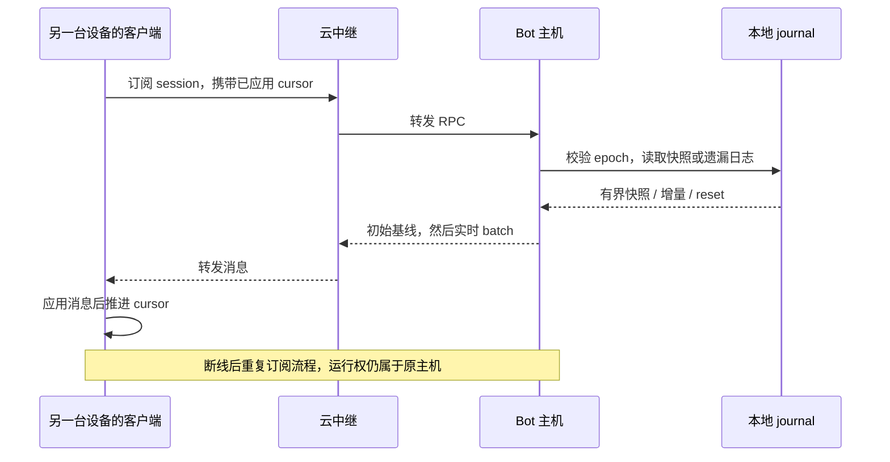
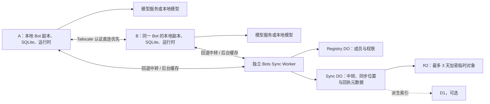

# Bot 与消息同步：Orca 源码分析与多端本地执行方案

本文保留2026-10-31的固定 Orca 源码分析、早期模型与阶段设计。正文中的“待实现”、
AGENTS/skills 范围和早期确认状态属于当时分析，不应作为当前缺失能力或交付状态。
当前简洁架构入口为 [SYNC-ARCHITECTURE](SYNC-ARCHITECTURE.md)，进度与准入为
[PLAN](PLAN.md)，实际原生/物理范围为 [SYNC-NATIVE](SYNC-NATIVE.md)；原失败与
验收事件仍见 [TESTING](TESTING.md)，本文不改现有协议。

all-path 历史交付 `193f75bd` 已含原始历史/完整版本资源、认证 direct、72h cache、online-holder
relay 与 all-path status。P5 source-v6 和受影响 normal gates 已接受；两机 API/SDK、
A/B 实际原生发送/重启与双方被动接收、B `482935b0` 及最终绑定已在有限范围正式接受。
B 发送前中断仍未定因，恢复后的通过不扩大该结论。
`peerApplied` 按当前完整身份/binding/source 的实际确认分开呈现，未知仍 unknown；
不再将早期“尚未接线”当现状。`182fc1f` 为历史共同基线；PR112 本轮先整合 `8674a3ee`，再追加实际 main 的固定点 `19f4a00a`。

## 已确认的产品要求

用户于本轮明确要求：**同一个 Bot 能在 A、B 两端本地运行；A 离线不能限制 B 继续
执行。两端共享一段对话，同时执行时保留分支。** 这属于第一版要求。
之前“每 Bot 固定一个运行主机，其他端只作客户端”的建议已被替代。

用户进一步确认：**云端不保存长期聊天历史，加密增量最多保留 3 天（72 小时），之后从
在线设备补齐。** 完整历史由各端持久保存；R2 不再承担长期归档或云端完整基线。

本版同时要求：**可用且通过认证的 Tailscale 连接优先，失败回退 Cloudflare，恢复后
稳定切回。** 直连与云中继共用同步协议；3 天云缓存继续独立后台写入。

采用多端本地执行、异步同步：每台就绪设备持有 Bot 的本地持久副本和自己的运行时，
在本地接纳消息、调用模型及工具，再同步变更。创建设备只记录来源，不决定永久运行权；
不使用 `homeDeviceId` 或云端 Bot 锁作为新一轮运行的前置条件。

Orca 的目录订阅、持久日志、游标恢复、命令去重、直连/中继和技能包仍是参考。
本次核对的 Orca 聊天链路没有证明同一会话在两个运行时的自动合并；Eagle 需要在这些
机制之上增加可运行的本地副本、因果历史与并发分支，不能把远程访问当作完整答案。

## 本地持久化与运行身份

同一个 `botId` 在 A、B 各有本地 SQLite、资源和 Harness。两端运行不同的回合，
各自先落盘再执行/发布；同步服务不可达不阻止它们使用已有本地数据继续运行。
模型服务本身仍需可用的网络或本地模型，每台设备需要就绪的资源和模型凭据。

| 身份 | 职责 |
| --- | --- |
| `botId` | 跨设备相同的 Bot 身份、定义和资源集合 |
| `conversationId` | 用户看到的同一段共享对话 |
| 分支和上下文 heads | 本轮实际基于哪些已知历史，用于识别并发及后续合并 |
| `runId` | 一次具体执行，记录发起设备、上下文基线和资源版本 |
| `replicaId + epoch + sequence` | 每个副本日志的持久位置，支持去重、缺口补读和备份恢复换代 |

**一个 Bot 可以同时有多个 run；一次 run 的执行与回执归属于它的执行设备。**
B 收到 A 的历史只导入记录，不把 A 已接纳的输入再次提交给模型，也不重做工具调用。
B 上的新输入创建 B 的 run。A 的 run 中途失联时保留其已知状态和未知结果，B 仍可
基于已有历史继续新 run；不靠复制 A 的未完成任务队列来实现双端运行。

新设备需向任一持有数据的在线副本取得声明覆盖范围的基线。已就绪的 B 在 A 离线时
仍可运行，并可从有效的 3 天缓存补增量；缓存过期或缺少基线时等待在线副本补齐。
不绑定创建设备，也不承诺新设备能在所有持有历史的设备离线时从云端恢复完整历史。

## 共享一段对话，并发保留分支

顺序使用时，B 收到 A 的历史后从最新分支继续。若两端从共同历史 H 同时开始，
两个回合都执行并保留，不按上传先后覆盖或强行串成“B 已读过 A 回复”的对话：

同步自动合并的是事件集合与分支关系。继续哪个分支、是否把多个分支并入下一轮上下文
是另一件事：默认沿用户当前分支继续；合并建立引用多个 heads 的新节点，保留原分支、
选入的内容和必要的合并说明。合并本身不自动再次调用模型；如用户要求总结，则作为
单独的新 run 记录。按时间平铺或只保留一份摘要，都不足以表达原来的上下文。

两端断联期间各自只能使用已经拥有的信息；联网后补齐双方历史。验收目标是已同步历史的
保真、并发内容不覆盖和最终收敛，不承诺运行时能知道尚未收到的消息。

### 可继续运行的历史必须比聊天界面完整

当前 [PiDurableRuntime](../../apps/bots/src/runtime/pi/PiDurableRuntime.ts) 为每个 Bot
打开 `session.sqlite`，`history()` 读取同一 root 的 entries。
[消息转换](../../apps/bots/src/runtime/pi/convert.ts) 是界面投影：内部 entries 不全显示，
[limits](../../apps/bots/src/runtime/pi/limits.ts) 只给最近 200 条窗口，超出 96 KiB 的
消息替换为提示。因此不能通过同步聊天气泡就声称 B 获得可无损继续的上下文。

需要单独定义可恢复的数据：原始消息及内容块、工具调用和已完成结果、附件引用、
指令/模型/技能版本、压缩记录及其覆盖范围、上下文 heads。模型实际使用哪些信息由
所选分支和上下文窗口决定；压缩不应删除原始历史，也不能拿 A 的摘要覆盖 B 的新分支。
不能表示的内容应保留原始对象并声明兼容性，不能静默省略后标为完整。

跨设备历史导入只形成被动记录。每台设备保留本地执行状态与 ID 映射，不互相覆盖正在
写入的 SQLite，不把另一设备的任务状态自动恢复成可执行任务。

## 指令、技能与工作区的共享范围

下表为待实现范围；跨端本地执行要求每端实际加载所选版本，不能只展示远端配置。

| 信息 | 多端行为 |
| --- | --- |
| 名称、外观、分组、模型、thinking、工具组 | 共享 Bot 定义；变更带来源与版本，运行记录本轮实际采用的配置 |
| 对话、工具结果、附件、压缩记录 | 同步原始内容及分支关系，各端持久化可运行的历史基线 |
| Bot 专属指令和 `AGENTS.md` | 作为版本化 Bot 资源分发，各端加载；并发修改保留冲突版本 |
| Skills | 同步启用列表、固定包版本和完整文件清单；各执行端安装并核对依赖 |
| Bot 自有长期记忆（如增加） | 作为有来源、版本及冲突规则的 Bot 资源；不混入机器全局记忆 |
| 项目规则、工作区文件 | 每端显式绑定本地工作区；选择共享的文件另行同步，不能用 A 的绝对路径冒充 B 的可用路径 |
| API key、设备私钥、系统权限、已安装程序 | 每台执行设备就绪并安全保存；不写入会话同步日志或普通资源包 |

`SKILL.md` 可能引用 `scripts/`、`references/`、`assets/`，需要完整包、版本、摘要和
依赖说明。`AGENTS.md` 的加载范围、项目规则优先级和生效时点也应写入契约。
资源完整落盘并加载后才标为可用；每轮固定所用版本。离线编辑产生的并发版本不静默
覆盖，发生冲突时可继续使用本地已选版本，待选择/合并后对后续运行生效。

同步会话不会自动合并两个工作区的文件修改或远端工具副作用。对同一外部目标的修改，
仍由该目标的执行策略、原子写入或版本冲突处理；历史中的两次工具结果都保留来源。

Eagle 当前 [工具装配](../../apps/bots/src/tools/registry.ts) 尚未接入 `AGENTS.md` /
`SKILL.md` 自动加载，`instructions` 字段也不代表文件加载与编辑已贯通。
Orca 则有独立技能包流程：云契约保存版本，manifest 要求 `SKILL.md` 并枚举文件，
客户端下载校验后分块传给选定 runtime。[O24] [O25] [O26]
所查入口默认允许 GCS；Eagle 采用 Worker 授权传输、各端保存完整技能包，R2 只可
限时中转。发布、安装确认和版本冲突处理仍需独立实现。

## 源码基线与证据边界

- 上游：[stablyai/orca](https://github.com/stablyai/orca)，本次新克隆远端 `main`，
  随后于 10:58（UTC+08）完成 `git pull --ff-only origin main` 复核。
- 固定提交：`6b937c7e5f5a8d2cfcb755c6708ac38a632b3012`，提交日期 2026-10-30，
  标题为 `fix(source-control): resolve delete/modify conflicts and complete merges from the panel (#35347)`。
- 本地参考仓库：`/Users/mengxionghan/workspace/orca`；分析链接均固定到上述提交。
  “最新”指本次拉取时核对的远端版本。
- Eagle 初次调研基线：`c34be59f6bce9f0cc8da10e614fd69a457bd8df4`；原工作区及其
  未提交改动保留。实施基线已改为个人 fork 的 `165d154d622d6d055b9851351355078f9b200425`，
  包含 `nocoo/main@d69359b` 与 #109；目录为 `/Users/mengxionghan/workspace/eagle-sync`。
  原源码证据仍保留；P0 按集成后的运行时、契约和实际接口重新验证可用性。
- 本次阅读了实现与相关测试，未安装或运行 Orca，未执行其测试套件。
  Orca 的生产 Terraform、部署配置和运维文档已迁往私有 `stablyai/orca-cloud`；
  这里依据公开运行时代码分析，不声称已审查私有部署或线上行为。[O1]
- Cloudflare 能力依据本次读取的官方文档；不创建云资源、不部署或采集生产数据。
  原始取证记录位于 `/Users/mengxionghan/workspace/eagle/.local/research/orca-sync-20261030/`；
  新基线记录位于开发目录的 `.local/sync-baseline/`。

Orca 没有与 Eagle `Bot` 完全同构的实体。此处对应的是它的 structured agent session：
会话记录、会话入口、运行状态和消息日志。支持哪些 Agent 类型的目录，不能当作用户
创建的 Bot 列表；编排系统的 agent-to-agent message 也不能混同于聊天正文。

## Orca 如何同步 Bot 对应的会话

### 身份、运行权和目录各有职责

`AgentSessionRecord` 保存稳定 `sessionId`、执行主机/工作区、provider、配置和会话名。
运行进程的 lease 单独保存 `runtimeFence`、进程身份与持有证据。
客户端窗口或 WebSocket 断线不授予另一个进程写入权。[O2]

会话记录和可见会话入口持久化在本机 SQLite。`session.tabs.list/listAll` 读取入口，
`session.tabs.subscribe/subscribeAll` 先给目录快照，再给变更；全目录订阅在扫描期间
缓冲变更，带上扫描的变更位置，避免把扫描中的新增/删除漏掉。只有明确标为
authoritative 的完整清点结果才有资格证明某项已不存在。[O3] [O17]

目录流还可按 capability 使用 `tabsRevision + baseRevision` 差量；基线绑定到
worktree 和当前订阅流，客户端找不到正确基线时拒绝拼接。它是目录传输优化，
不等于持久消息游标。[O4]

### 状态是另一条订阅流

`agentSession.subscribeStatus` 首先发布会话状态快照，再按会话推送变化。
会话名、模型选项与实际运行状态来自主机记录和日志投影；移动端同一 RPC client
共享一个状态流。失联时撤去主机在线证明，保留已有内容，不根据断线推断任务结束。
[O5] [O18]

Eagle 可以复用这种职责划分，但要增加多端执行的语义：

- Bot 目录：稳定 ID、名称、外观、各端副本、非敏感配置、删除事实。
- Bot 状态：按设备/run 展示在线证据与运行状态；一台离线不表示其他端不能运行。
- 聊天窗口：订阅共享历史及分支；每台执行设备有独立 Harness 和本地会话映射。

## Orca 如何同步 message

### 本地主机的 journal 是恢复依据

每个 profile 使用 `agent-session-journal.db`，不是把每条聊天写进云端 PostgreSQL。
核心日志表的主键是 `(session_id, epoch, seq)`，行保留 JSON；另有会话记录和命令回执表。
单写入队列分配顺序，事务提交日志和关联回执，再通知内存投影/订阅者。
[O6] [O19] [O20]

这里有三个不同的编号：

| 编号 | 解决的问题 |
| --- | --- |
| `sessionId` | 哪一段持久会话，与窗口/连接寿命无关 |
| `epoch + sequence` | 当前日志世代及已经应用到的位置，用于增量补读 |
| `itemId + revision` | 同一消息/工具项更新多次时，用新版替换旧版 |

例如 assistant 逐步输出时，同一 item 产生修订；客户端按 `itemId` 合并，仅采用不旧于
已知 revision 的内容。消息创建位置与后续修订的日志位置分开，避免旧消息在更新后
跳到末尾，也避免按创建位置补读时漏掉旧消息的新修订。[O7] [O21]

持久化还有一个细节：Orca 对纯 assistant 文本修订可以使用 SQLite `NORMAL`，其他
提交与最终结算恢复 `FULL`。它允许 OS 崩溃丢失尚未最终刷盘的文本尾部。因此不能把
“看见流式文字”当作最终结果已经安全保存的证明。[O19]

### 首次快照、增量补读与 reset

客户端调用 `agentSession.subscribe({sessionId, cursor?})`：

1. 没有 cursor：发送有界的最近历史快照，随后跟随实时更新。
2. cursor 有效：从已应用位置补读，投影为 `batch`，再继续订阅。
3. 日志换 epoch、客户端游标超前或游标已压缩：返回 `reset` 和新基线。
4. 对支持相应 capability 的客户端，落后过多可以改发最近窗口快照；更早消息通过
   `agentSession.history` 单独分页读取，不能声称这个窗口包含全部历史。[O8] [O22]

每个订阅者独立推进 cursor。重连携带的是客户端**已经应用**的游标；读取和订阅
使用 generation guard，旧连接或旧分页请求的迟到响应不会覆盖新基线。[O9]

客户端对普通 assistant 更新采用约 48 ms 合并窗口；快照、删除、队列和交互请求等
需要及时改变状态的事件绕过合并。历史页同时受条数与字节预算限制，不能只限制
“200 条”却允许单条内容撑爆通道。[O10] [O21]

### 发送重试以持久回执为准

发送携带稳定 `clientOperationId`，并对应乐观显示的 `clientMessageId`。
主机把方法、session 和内容指纹绑定到回执：同一身份和内容返回已有结果，内容冲突
则拒绝；send 可跨已认证调用者去重，其他命令采用各自的调用者作用域。[O11]

回执与产生的日志变更在同一数据库事务提交。provider 已接受但结果未知时，不能
为了重连重新启动一轮模型调用；已经消费的操作缺少完整结果时保留 unknown。
Orca 为这种崩溃窗口、回执重开、游标换代和压缩恢复保留了测试。[O12] [O23]

### 云 relay 的作用

公开 cloud workspace 使用 director 分配 cell，主机主动建立 control WSS，客户端
连接 cell 后协调主机的数据连接，cell 双向 splice 帧。生产控制数据使用 PostgreSQL，
本地/测试使用 SQLite。中继实现有队列、字节预算和背压超限关闭。[O1] [O13]

所查 mobile relay 数据通道使用设备公钥固定及 E2EE v2：中继路由会话，主机和客户端
解密业务消息；认证/控制元数据仍由云服务处理。这个结论限定于所查通道，不能推广
成“Orca 所有连接和所有云数据都端到端加密”。[O14]

移动端聊天 hook 保留最多 32 个会话的内存状态，网络中断时可继续显示已加载内容。
这与“全新客户端在主机离线时向云端下载完整历史”是不同的能力。[O15]

另一个值得参考但独立的机制是 `orchestration.federationPull/federationAck`：远端编排
消息按 sequence 分页拉取、检查连续性、持久导入去重后确认。它有对端身份、runtime epoch
和生命周期确认边界；这里借鉴“导入后 ACK”，不把编排数据表移作聊天同步库。[O16]

## Orca 手机与多 Mac 的连接方式及延迟

手机保存配对主机的直连 endpoint。生命周期代码同时构造 direct RPC 与 relay RPC，
直连路径区分 LAN/Tailscale；拥有有效 relay 配对时，由 supervisor 管理切换。[O27] [O28]

- 优先尝试直连。若仍停在 connecting/handshaking，当前源码给 2.5 秒窗口后开始 relay
  竞争；明确连接失败也会进入恢复。这是建连/恢复策略，不是每条消息增加 2.5 秒。[O29]
- relay 上保持长连接，并探测能否回到直连。默认每 15 秒探测；切回要求连续成功、
  观察期和最小驻留时间，避免 Wi-Fi 波动导致反复换线。[O30] [O31]
- 新连接认证成功后才切换，重新附着订阅并以 generation 隔离旧回调；中断请求保留
  “是否已送达未知”的事实。消息层再用游标补读及持久回执恢复。[O32]

这些入口使用已保存的可达地址；不能据此声称实现了自动 NAT 打洞，或每条 Tailscale
连接都物理直达。手机在这些路径上仍访问所选主机的会话运行时。

桌面访问远端 runtime 时，所查路径选择已配对的 WebSocket endpoint，使用带主机公钥
验证的握手；由 SSH 托管的 runtime 会先准备/恢复隧道。Mac B 可以经可达网络地址或
SSH 隧道访问 Mac A 的 runtime，不要求每次都经过手机的云 relay。[O33] [O34] [O35]
本次没有把手机的自动直连/relay 切换推定为所有桌面路径都具备的行为。

Orca 的消息采用订阅推送，普通 assistant 更新在客户端约 48 ms 合并后显示，交互请求、
队列和非 assistant 变更等绕过这段合并窗口；relay 双向转发帧，不等待完整回答才回传。
[O10] [O13] 初次建连、从后台恢复和补齐历史的等待应与已建立连接后的流式延迟分别测量。

对于远程运行，首个响应包括客户端到运行主机的请求/返回路径、主机落盘与排队、模型
首字时间及客户端刷新；流式输出无需为每个 token 单独往返。没有本轮实测数据，不能
给出“固定增加多少毫秒”的承诺。对 Eagle 已确认的本地执行模式，模型调用直接从当前
设备发起，同步在旁路进行，正常回复不等待 Cloudflare 或另一台 Mac 的确认。

## Eagle 已有基础与实现缺口

#109 已提供设备配对/群身份、helper 私有文件凭据与后台服务、独立设备 Worker、
Registry/执行 DO 及 [SharedDevicePort](../../apps/bots/src/tools/devices/port.ts)。
该 port 的 `directory/request/approve/begin` 处理设备发现与执行授权，不提供会话
复制、加密同步密钥或 Tailscale 端点。同步通过新的版本化接口接入；helper 仍独占
设备私钥，不能扩用受限注册 signer 签任意数据。详见 [开发边界](PLAN.md#开发基线与-pr-边界)。

| 部位 | 当前源码中的基础 | 多端本地执行需要补充 |
| --- | --- | --- |
| Bot 目录 | [BotDirectory](../../apps/bots/src/core/BotDirectory.ts) 原子 JSON 写入 | 全局 Bot 身份、本地副本索引、版本化配置与并发删除规则 |
| 本地运行 | [PiDurableRuntime](../../apps/bots/src/runtime/pi/PiDurableRuntime.ts) 每 Bot 一个 SQLite/Harness | 同一逻辑 Bot 在不同设备的独立运行；conversation/branch/run 到本地 pi ID 的映射 |
| 实时消息 | [EventHub](../../apps/bots/src/core/EventHub.ts) 排序、合并 delta、有界分发 | 内存 rev 不作跨端游标；增加持久源日志、来源设备、因果 heads 和分支投影 |
| 首帧与历史 | [ConversationService](../../apps/bots/src/core/ConversationService.ts) 快照和分页 | 可恢复的完整上下文出口、被动导入、历史覆盖范围和分支切换 |
| 发送恢复 | [OutboxStore](../../apps/bots-macos/Sources/BotsFeatures/OutboxStore.swift) 发前落盘、按 requestId 恢复 | 区分本机发送与历史导入；全局 operation/run 身份，重连不重复发起运行 |
| 原生连接 | [ConversationSocket](../../apps/bots-macos/Sources/BotsTransport/ConversationSocket.swift) rev 缺口 resync | 本机执行保持可用；独立同步连接、缺口补读、路径切换及分支 UI |
| 生命周期 | [BotsDaemonSupervisor](../../apps/macos/Sources/EagleFeatures/BotsDaemonSupervisor.swift) App 退出时结束自己启动的 daemon | 定义本端退出后的运行和同步生命周期；其他端可独立执行 |

原调研安装的 `pi-durable` 已核对为 `1.4.0`，集成基线仍锁定该版本；以下依据其
[README](../../apps/bots/node_modules/@earendil-works/pi-durable/README.md) 与
[公开会话类型](../../apps/bots/node_modules/@earendil-works/pi-durable/dist/harness/types.d.ts)：

- `context({at})` 可读某个已提交位置的原始 active entries 和模型消息，`entries()`
  提供历史；`fork(at)` 在同一存储里创建独立分支，并使用新的 provider session identity。
  这是可复用基础，尚未证明跨 SQLite 导出/导入或多父节点合并已经可用。
- `Conversation.submit` 区分 input 与被动 write；底层事务可 append entries。
  P0 必须验证导入模式不会启动生成或工具，且能重建相同上下文、工具关联和资源版本。
- `resume()` 会启动任务调度，Eagle 在 open 后立即调用它；submit/wait 等也可能启动
  调度。不能把另一副本的未完成任务、inbox 和 provider session 身份直接复制进本机。
- watch/watchEvents 以快照开始，慢消费者退化为新快照，不重放全部遗漏帧；需要可恢复
  的同步出口。compaction 保留原始历史，摘要有覆盖范围，不能用于消除并发分支。
- 设置、扩展和工具部分按模型请求或任务阶段解析。要求整轮固定资源版本时，必须验证
  适配器的版本固定机制，不能把“下一请求生效”误报为“整个 run 不变”。

如果需要额外的同步投影库，必须恢复“pi 已提交、投影还没提交”的窗口：优先复用公开
持久位置与事务能力，或增加可验证的扫描重建机制。事件回调里顺手写另一个 SQLite
不构成跨库事务。无法补齐的情况应明确重建基线，同时保留未发布的删除/分支事实。

`openDurableObjectSqliteStorage` 只提供存储适配器，本次不把本地 Node 工具搬进 Worker。
云端处理同步与分发；多端执行继续使用各端实际的文件系统、程序和权限。

## Cloudflare 的职责

| 部件 | 建议职责 | 是否阻塞本地新 run |
| --- | --- | --- |
| 独立 Bots Sync Worker | 认证入口、直连不可用时的 WebSocket 中转、限时缓存传输及在线副本补读 | 否 |
| 设备 Registry DO | 设备群成员、配对与撤销的权威状态 | 不因临时失联停掉已有本地副本；网络访问仍检查有效权限 |
| 每设备群的目录 Sync DO | 共享 Bot 当前目录、副本位置和删除事实；群内设备发现接口提供身份绑定的 Tailscale 候选端点，不存聊天正文 | 否 |
| 按 Bot 分片的 Sync DO | 中转消息，保存来源位置、去重/回执元数据、限时对象清单；消息正文不写 DO SQLite，不持有唯一 Bot 执行锁 | 否 |
| R2 | 加密增量及临时大对象，首次缓存后最多 3 天（72 小时）；到期删除，不归档长期历史或完整聊天基线 | 否；缺失旧数据向在线副本补齐 |
| 可选 D1 | 跨 Bot 查询索引，作为派生读模型 | 否 |
| 可选 Queues | 临时对象清理等异步任务，按原操作身份去重 | 否 |

同机 UI 始终连接本机 daemon。Tailscale 认证直连属于本版范围，Cloudflare 作为
回退中转与 3 天补发通道；两种 transport 使用相同日志身份、补读和确认规则。
通用 LAN 自动发现仍可后续增加。连接选择只影响传输，不改变 run 的执行设备。

设备服务只在已认证的设备群内发布带设备身份的 Tailscale IP/MagicDNS 名称及同步
端口；同步专用入口仅向 Tailscale 网络开放，管理接口保持本机边界。没有 Tailscale
或候选端点时直接用云通道。地址可达不等于应用授权，握手仍校验设备公钥、群成员
权限和加密上下文，切路不能绕过授权失败；不因使用 Tailscale 自动信任任意对端。

本机连接管理器优先尝试直连。参考 Orca 建议以 2.5 秒作为握手等待后启用中继竞争的
初值；已知网络失败立即回退。使用中继时建议每 15 秒由本机探测直连，连续成功并
达到稳定窗口/最小驻留条件才切回。这些是初始设计参数，不是实测延迟承诺。[O29] [O30] [O31]
新通道认证成功后重新附着同一订阅，旧通道回调按连接 generation 隔离。切换或双路
到达不改事件 ID、应用游标或 run 身份，不重复接纳输入或执行工具。[O32]

直连成功时，实时数据和历史/资源补读优先走它；新增持久增量仍后台写入云端缓存，
供未同时在线的其他副本恢复。对端应用 ACK 与云缓存 ACK 分别记录，直连成功不表示
云端已有副本，也不刷新 72 小时到期点。这里的应用直连绕过 Eagle 云中继；Tailscale
自身可能经 DERP，不能从地址标签推断底层物理 P2P。[O27] [O28]

DO 不持久保存 input/output、工具结果或历史摘要；SQLite DO 的 PITR 可恢复过去
30 天的数据，不能靠删除消息行宣称满足 3 天保留上限。[C2]
正文缓存只放 R2：到期停止补发并执行对象删除，生命周期规则仅作清理兜底；验收必须
区分拒绝读取和已删除，覆盖删除失败重试。服务端记录首次缓存时间，按连续 72 小时
计算到期点，不按自然日；读取、重传和设备离线均不续期。缓存 ACK 不允许源端
删除唯一的本地历史。正文不进入日志、追踪、DO attachment 或其他归档通道。
完整基线和过期历史从在线副本分块透传；没有持有者在线时，只能使用本机已有上下文。
若完全不缓存，则收发两端必须有在线时间重叠才能补齐缺口；本地独立执行不受影响。

Cloudflare 官方语义仍需遵守：

- 两端主动建立 WebSocket，在 DO 一侧是入站连接，可使用 Hibernation API；休眠后
  从持久状态和非敏感 attachment 恢复，不依赖内存 Map 常驻。[C1]
- DO SQLite 只提供单个对象的事务；跨 Registry/Sync DO/R2 不假设分布式原子提交。
  KV 的最终一致性不用于权限撤销或成员判断。[C2] [C3]
- D1 开启读副本时用 Sessions/bookmark 控制所需一致性；不能因旧索引回滚已应用日志。[C4]
- R2 临时对象写入完成并校验后再发布带到期时间的 manifest。R2 的强一致性不等于
  R2/DO 联合事务；回包丢失按原对象身份恢复，缓存确认不能当作长期备份证明。[C5]
- Queues 至少一次投递；队列 ACK 不能代替模型接纳回执或副本持久化确认。[C6]
- DO 的实际位置影响同步延迟，不是每个客户端附近同时运行一份同名对象。当前官方文档
  说明位置在初次创建时确定，`locationHint` 仅为尽力而为且只在首次生效；不要从任意
  CI 地区预建对象后假设其已靠近用户。[C7]

### 容量与费用基线

2026-10-30 核对的公开标准价如下，用于 P6 估算。Workers Paid 最低 $5/月，包含额度
在账号内共享；R2 独立计费，并有 Standard 免费层。这里没有把 $5 设为费用硬上限。
这些数据是费率证据，尚未测量 Eagle 同步的实际用量；当前只估算限时中转，不规划
云端长期聊天容量。[C8] [C9] [C10]

| 项目 | 每月包含额度 | 超额标准价 |
| --- | --- | --- |
| Workers | 1,000 万请求；3,000 万 CPU 毫秒 | $0.30/百万请求；$0.02/百万 CPU 毫秒 |
| DO 计算 | 100 万计费请求；40 万 GB·秒活跃时长 | $0.15/百万请求；$12.50/百万 GB·秒 |
| DO SQLite 容量 | 5 GB·月，账号内对象合计 | $0.20/GB·月 |
| DO SQLite 读写 | 读 250 亿行；写 5,000 万行 | $0.001/百万读行；$1.00/百万写行 |
| R2 Standard 容量 | 10 GB·月 | $0.015/GB·月 |
| R2 操作 | A 类 100 万次；B 类 1,000 万次 | A 类 $4.50/百万次；B 类 $0.36/百万次 |

R2 A 类主要是写入、列举等操作，B 类主要是读取；Standard 出口流量免费。
GB·月是存储量与时间的计费单位，不能把免费额度当作上传流量额度。DO、R2 的部分
超额按官方计费单位向上取整；R2 免费层不适用于 Infrequent Access。[C9] [C10]

DO WebSocket 入站消息按 20:1 折算计费请求，出站消息不收请求费；满足休眠条件的
空闲对象不计活跃时长。使用 Hibernation API，避免普通长连接或周期定时器让每个
Bot 对应对象持续驻留计费。增量缓存采用批次和不可变临时对象，不能每个 token 写一次 R2。

硬边界与包含额度不同：付费 SQLite DO 单对象最多 10 GB，账号总量和对象实例数量
不设相同上限；R2 单桶总存储量不限，但同一对象 key 的写入上限为每秒一次。[C11] [C12]
因此 DO 只保存有界同步元数据，正文及附件若进入 R2 则最多保留 3 天。
缓存到期不推进任何副本的应用位置，缺失数据由本地持久副本补齐。

例如对象在 3 天内不断轮换、始终占用 100 GB 持续一个月，R2 容量超额费仍为
`(100 − 10) × $0.015 = $1.35`；单个对象最多保留 3 天不意味着账号只计 3 天容量。
只有其他用量均在包含额度内时，Workers 基础费加这项容量费才约为 $6.35/月。
实际预算还要扣除同账号其他项目已使用的额度，并计入请求、SQL 读写和 DO 活跃时间；
模型 API 费用另算。P6 将本地延迟、另一端可见延迟与月费用分别报告。

### 与设备配对、执行边界的关系

[DEVICE-PAIRING.md](DEVICE-PAIRING.md) 的 Registry 是拟议能力。设备群可以承接共享
身份，但其现有执行契约尚未定义 Bot 历史读取/资源共享权限，需要补充。UI Bot 文件夹
`groupId` 和设备群 ID 不能混用；创建设备 ID 不是唯一允许发布 Bot 变更的身份。

Bots Sync 保持独立构建、部署、协议和测试，通过宿主注入的 port 对接设备身份。
不 import Eagle Worker/Agent/contracts，也不把聊天写入机器报告和原有遥测表。
已有执行方案对某个目标设备的串行策略，不等于限制同一个 Bot 在不同设备运行。

同步入口检查来源设备及共享权限；客户端验证资源摘要、来源与日志身份。E2EE、数据
密钥分发、设备安全存储和撤销后轮换都需实现验证，当前 TLS 连接不能描述为已具备这些
能力。密钥不进入普通日志、D1 或资源包；撤销阻止后续网络共享，不能承诺擦除其他设备
已下载的历史，或在完全断联时远程阻止其使用已有本地数据。

## 合并与恢复必须满足的规则

1. **每个来源有自己的顺序。** 本地持久化 `replicaId + epoch + sequence`，消息还带
   `itemId + revision`，跨来源用因果 heads 关联。云端接收顺序可作分页索引，但不决定
   模型当时见过什么。恢复旧备份需新 epoch，不能重用身份写入不同内容。
2. **导入后确认。** 先验证、去重并落盘，再推进该来源的连续确认点；迟到、重复和
   缺口不能跳过。缺父事件时先保存待补齐数据，不把不完整上下文发布为完整基线。
3. **并发不覆盖。** 相同父节点的不同 run 保留分支；单一消息的修订只由其来源产生。
   指令/技能的并发修改保留版本冲突，普通展示字段的合并策略也需明确且可重复计算。
4. **历史导入不执行。** run 意图、执行状态和历史投影分开；仅本端接纳的新意图或
   本端合法恢复的 run 进入本地调度器。跨端重试保留 operation/run 身份和执行目标，
   结果未知不自动改发到另一设备。用户主动新开回合是另一个 run。
5. **基线声明范围。** 快照携带各来源的连续位置、分支 heads、资源版本和 schema；
   导入完成后原子发布。最近 200 条窗口不能充当完整副本或据此删除更早历史。
6. **实时与持久分开。** 未结算输出可实时显示，最终记录从持久源补齐；只有具备完整
   依赖的基线可作为下一轮上下文。普通本地回复不等待其他副本或云端落盘确认。
7. **删除有明确事实。** 保留 tombstone；旧设备回连不能自动复活已删 Bot。离线并发
   新回合不能静默丢弃，要保留可恢复内容和冲突事实；恢复采用明确的新版本操作。
8. **状态保留来源。** 展示各端 run 状态和新鲜度；失联是未知，不能推断任务完成，
   也不能用 A 的离线状态禁用 B 的新输入。
9. **环境依赖明确。** 已同步技能文本不等于脚本依赖、文件和权限已就绪。首次建立副本
   验证实际加载的资源及工作区绑定；每轮记录使用的版本，避免换端后悄悄换一套规则。
10. **缓存不是备份。** 云端缓存确认携带到期时间，已见过/已应用范围与仍可补发范围
    分开记录。首次缓存满 72 小时后删除临时对象，重试不续期；缺口从持有数据的在线副本补齐。
11. **切路不换身份。** Tailscale/Cloudflare 使用同一设备授权、事件与去重规则；
    旧连接迟到不能覆盖新状态，直连 ACK 不能代替云端缓存 ACK，断线不重新执行未知操作。

## 实现切片与验收

交付顺序和状态统一留在 [PLAN.md](PLAN.md#多端-bot-整体实施计划2026-10-30) 的
P0–P6。本表只列同步领域的验收要求，不建立另一套交付状态；以下尚未实现：

| 验收领域 | 关联阶段 | 关键验收 |
| --- | --- | --- |
| 上下文导出/导入 | P0 | 独立 SQLite 重建相同历史和模型上下文；无隐式生成/工具执行；pi 提交与同步出口的崩溃窗口可恢复 |
| 本地运行副本 | P1 | A 停止后 B 发新消息并成功执行；云不可达仍可本地接纳；重启恢复本端 run |
| 共享对话与并发分支 | P1/P5 | A/B 从共同历史同时运行；反向/重复/断点同步均收敛；两支均保留，选择/合并后继续不重做工具 |
| 指令与技能资源 | P2 | 两端实际加载相同固定版本；并发编辑可恢复；文件/附件/工具结果无静默丢失 |
| 身份与共享权限 | P3/P4 | 配对、共享范围、被撤销设备、密钥分发及轮换有完整行为证据；本地执行与远程访问权限分别验证 |
| Tailscale 优先与自动切换 | P3/P4/P6 | 端点发现与认证、不可达/断开后的回退、恢复后稳定切回、旧回调及双路重复；物理双 Mac 记录实际网络路径 |
| Cloudflare 中转与限时补发 | P4 | 本地 Miniflare/DO/R2 验证发布/ACK 断点、72 小时到期边界与对象删除、读取/重试不续期、在线副本补读；不把缓存确认当作对端应用 |
| 真实多机与费用 | P6 | 物理双 Mac 同时执行、A 关机、B 重启与重新合并；分别报告响应/同步时延和按实际用量估算的费用 |

P0 起按严格 TDD 落地；先证明失败行为，再最小实现和正常门禁。不用纯内存或 mock-only
测试代替真实 SQLite/进程恢复。应分别记录本地发送到接纳、模型首字、另一端可见及
首次副本就绪的 p50/p95；网络条件和冷/热连接分别报告，不把模型耗时混入同步耗时。

实现同时更新 PRODUCT、ARCHITECTURE、PROTOCOL、RUNTIME、OBSERVABILITY、TESTING 的
受影响契约与 fixtures，保持 v1 additive-only，现有 rev 语义不改；新能力通过协商开放。
Bots daemon、Swift 客户端和同步服务各有正常门禁，root check 不自动覆盖全部 Bots。
部署/发布仍按项目规则另行授权并执行既有检查。

本轮完成设计及源码交叉核对；尚无新的运行测试、延迟实测、物理双 Mac 或云端交付证据。
双端本地执行与共享对话并发分支已由用户确认，协议字段、上下文适配和资源管理仍待实现。

## 固定源码与官方参考

主要入口：[目录][O3]、[消息补读][O8]、[发送去重][O11]、[中继][O13]、
[手机路径切换][O27]、[Cloudflare WebSocket][C1]、[DO 位置][C7]。正文的 O 编号固定到此次 Orca 提交，C 编号指向官方文档。

[O1]: https://github.com/stablyai/orca/blob/6b937c7e5f5a8d2cfcb755c6708ac38a632b3012/cloud/README.md
[O2]: https://github.com/stablyai/orca/blob/6b937c7e5f5a8d2cfcb755c6708ac38a632b3012/src/shared/agent-session-record.ts#L35
[O3]: https://github.com/stablyai/orca/blob/6b937c7e5f5a8d2cfcb755c6708ac38a632b3012/src/main/runtime/rpc/methods/session-tabs-inventory.ts#L88
[O4]: https://github.com/stablyai/orca/blob/6b937c7e5f5a8d2cfcb755c6708ac38a632b3012/src/shared/session-tabs-tab-delta.ts#L1
[O5]: https://github.com/stablyai/orca/blob/6b937c7e5f5a8d2cfcb755c6708ac38a632b3012/src/main/native-chat/agent-session-wire/structured-agent-session-status-feed.ts#L69
[O6]: https://github.com/stablyai/orca/blob/6b937c7e5f5a8d2cfcb755c6708ac38a632b3012/src/main/native-chat/agent-session-journal/journal-row-writer.ts#L55
[O7]: https://github.com/stablyai/orca/blob/6b937c7e5f5a8d2cfcb755c6708ac38a632b3012/src/shared/structured-agent-session-history-state.ts#L64
[O8]: https://github.com/stablyai/orca/blob/6b937c7e5f5a8d2cfcb755c6708ac38a632b3012/src/main/native-chat/agent-session-wire/agent-session-subscriber-catch-up.ts#L51
[O9]: https://github.com/stablyai/orca/blob/6b937c7e5f5a8d2cfcb755c6708ac38a632b3012/src/shared/structured-agent-session-live-read.ts#L47
[O10]: https://github.com/stablyai/orca/blob/6b937c7e5f5a8d2cfcb755c6708ac38a632b3012/src/shared/structured-agent-session-coalescer.ts#L8
[O11]: https://github.com/stablyai/orca/blob/6b937c7e5f5a8d2cfcb755c6708ac38a632b3012/src/main/native-chat/agent-session-wire/structured-agent-session-mutation-plans.ts#L126
[O12]: https://github.com/stablyai/orca/blob/6b937c7e5f5a8d2cfcb755c6708ac38a632b3012/src/main/native-chat/agent-session-journal/journal-crash-boundary.spec.ts#L76
[O13]: https://github.com/stablyai/orca/blob/6b937c7e5f5a8d2cfcb755c6708ac38a632b3012/cloud/apps/relay/src/splice-forwarder.ts#L47
[O14]: https://github.com/stablyai/orca/blob/6b937c7e5f5a8d2cfcb755c6708ac38a632b3012/mobile/src/transport/mobile-relay-e2ee-link.ts#L49
[O15]: https://github.com/stablyai/orca/blob/6b937c7e5f5a8d2cfcb755c6708ac38a632b3012/mobile/src/session/use-mobile-structured-agent-state.ts#L28
[O16]: https://github.com/stablyai/orca/blob/6b937c7e5f5a8d2cfcb755c6708ac38a632b3012/src/main/runtime/orchestration/federation-sync.ts#L45
[O17]: https://github.com/stablyai/orca/blob/6b937c7e5f5a8d2cfcb755c6708ac38a632b3012/src/main/runtime/rpc/methods/session-tabs.ts#L28
[O18]: https://github.com/stablyai/orca/blob/6b937c7e5f5a8d2cfcb755c6708ac38a632b3012/mobile/src/session/mobile-structured-session-status-feed.ts#L121
[O19]: https://github.com/stablyai/orca/blob/6b937c7e5f5a8d2cfcb755c6708ac38a632b3012/src/main/native-chat/agent-session-journal/journal-host-database.ts#L14
[O20]: https://github.com/stablyai/orca/blob/6b937c7e5f5a8d2cfcb755c6708ac38a632b3012/src/main/native-chat/agent-session-journal/journal-database-schema.ts#L9
[O21]: https://github.com/stablyai/orca/blob/6b937c7e5f5a8d2cfcb755c6708ac38a632b3012/src/main/native-chat/agent-session-wire/agent-session-history-page.ts#L3
[O22]: https://github.com/stablyai/orca/blob/6b937c7e5f5a8d2cfcb755c6708ac38a632b3012/src/main/native-chat/agent-session-journal/journal-cursor.ts#L26
[O23]: https://github.com/stablyai/orca/blob/6b937c7e5f5a8d2cfcb755c6708ac38a632b3012/src/main/native-chat/agent-session-journal/command-receipt-table.spec.ts#L60
[O24]: https://github.com/stablyai/orca/blob/6b937c7e5f5a8d2cfcb755c6708ac38a632b3012/src/shared/skill-cloud-contract.ts#L15
[O25]: https://github.com/stablyai/orca/blob/6b937c7e5f5a8d2cfcb755c6708ac38a632b3012/src/shared/skill-package-manifest.ts#L14
[O26]: https://github.com/stablyai/orca/blob/6b937c7e5f5a8d2cfcb755c6708ac38a632b3012/src/main/skills/skill-client-mediated-transfer.ts#L18
[O27]: https://github.com/stablyai/orca/blob/6b937c7e5f5a8d2cfcb755c6708ac38a632b3012/mobile/src/transport/mobile-endpoint-lifecycle.ts#L90
[O28]: https://github.com/stablyai/orca/blob/6b937c7e5f5a8d2cfcb755c6708ac38a632b3012/mobile/src/transport/mobile-direct-endpoint-probe.ts#L5
[O29]: https://github.com/stablyai/orca/blob/6b937c7e5f5a8d2cfcb755c6708ac38a632b3012/mobile/src/transport/mobile-relay-direct-grace-timer.ts#L4
[O30]: https://github.com/stablyai/orca/blob/6b937c7e5f5a8d2cfcb755c6708ac38a632b3012/mobile/src/transport/mobile-direct-return-probe.ts#L7
[O31]: https://github.com/stablyai/orca/blob/6b937c7e5f5a8d2cfcb755c6708ac38a632b3012/mobile/src/transport/mobile-endpoint-supervisor.ts#L34
[O32]: https://github.com/stablyai/orca/blob/6b937c7e5f5a8d2cfcb755c6708ac38a632b3012/mobile/src/transport/stable-logical-rpc-client.ts#L232
[O33]: https://github.com/stablyai/orca/blob/6b937c7e5f5a8d2cfcb755c6708ac38a632b3012/src/shared/runtime-environments.ts#L279
[O34]: https://github.com/stablyai/orca/blob/6b937c7e5f5a8d2cfcb755c6708ac38a632b3012/src/shared/remote-runtime/requests/remote-runtime-request-websocket.ts#L104
[O35]: https://github.com/stablyai/orca/blob/6b937c7e5f5a8d2cfcb755c6708ac38a632b3012/src/main/managed-server/lifecycle/orcad-managed-tunnel.ts#L59
[C1]: https://developers.cloudflare.com/durable-objects/best-practices/websockets/
[C2]: https://developers.cloudflare.com/durable-objects/best-practices/access-durable-objects-storage/
[C3]: https://developers.cloudflare.com/kv/concepts/how-kv-works/
[C4]: https://developers.cloudflare.com/d1/best-practices/read-replication/
[C5]: https://developers.cloudflare.com/r2/reference/consistency/
[C6]: https://developers.cloudflare.com/queues/reference/delivery-guarantees/
[C7]: https://developers.cloudflare.com/durable-objects/reference/data-location/
[C8]: https://developers.cloudflare.com/workers/platform/pricing/
[C9]: https://developers.cloudflare.com/durable-objects/platform/pricing/
[C10]: https://developers.cloudflare.com/r2/pricing/
[C11]: https://developers.cloudflare.com/durable-objects/platform/limits/
[C12]: https://developers.cloudflare.com/r2/platform/limits/

## Local durable encrypted object delivery8b5ca36 at base4f7d035

The delivered P4 slice uses helper-owned persistent X25519 wrapping keys and signed,typed metadata
through the independent version1 device port. Bots persists immutable cipher/manifest/self-envelope
or accepted recipient pin results under its own root and exposes additive objects/pull and stored
objectId-only passive apply. Existing direct page,ordinary local execution and SDK history bytes
retain their delivered contracts. See PROTOCOL and SYNC-ARCHITECTURE for exact fields/fences;
TESTING/source-v3 fe2e2ecd and authoritative objects-delivery-final.json SHA072acfa9 record the
real owned helper/Registry SQLite,crash,offline cold-start and actual normal delivery gates.
Own-fork8b5ca36/tree20d3fe12 and clean/ahead0/behind0 were verified;289 historical and40 delivery
originals retain old gate scopes and settled trace correctiona40bae3e. This is local controlled
acceptance,not CF caching or physical Tailscale/App acceptance. Agent1.2.0 remains unpublished
source and onboarding1.0.0 is unchanged;no deployment,publication or owner-online dependency.

After that clean delivery,upstream/main5d48ba0a was fetched and verified as #109's normal merge,
with the same tree as common ancestor/original dependency165d154 and no source delta. This
baseline integration has sync parent8b5ca36 and upstream parent5d48ba0a,preserving the published
sync chain and every source byte;only status docs change. Actual normal commit and remote
results belong to the final .local/sync-upstream-109 delivery receipt;preparation is not delivery.
